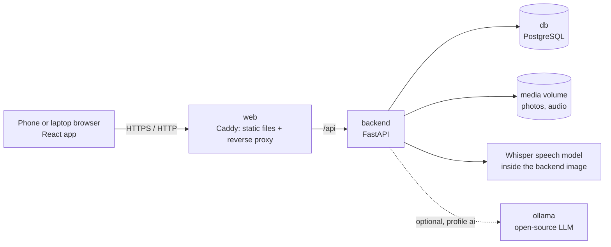

# DeskLess

**Inspection reports, without the desk.** For anyone who walks a place and has to write up what is wrong with it: a construction project, a college, a government office, an apartment block, a mall, a hospital. Walk it, photograph each issue and say what is wrong in your own mix of Hindi and English. DeskLess turns the voice note into English text, structures it (issue, location, severity, owner, due date) and builds a formatted English PDF report. The models run on the phone and a report is made with no network. When the phone has a network, the finished report goes to the company's server, where each role has its own dashboard.

Team **techazsure** · iQOO Hackathon 2026 Grand Finale · Productivity track

## What is in this repository

| Folder | What it is | Written |
|---|---|---|
| `android/` | **The finale build.** A native Android app that does everything on the phone: camera, voice, speech-to-text and a language model on the device, readings from the phone's sensors, PDF report, and reports passed from phone to phone with no network. No server takes part in making a report, and once signed in the app captures and builds reports in airplane mode. | During the finale, 9–11 Oct 2026 |
| `server/` | **The server.** Accounts for five roles (sign-up with a code sent by email, approval by the level above, sign-in with a unique ID), the reports the phones send, the work on their issues, a web console for each role, and an assistant that summarises and ranks every issue, names who could take it and drafts the next step. Its bare address is the home page that presents all of this, with the film, the pitch deck and the way in. | During the finale, 9–11 Oct 2026 |
| `docker-compose.server.yml`, `deploy/` | **The server on a real machine.** The server and its database alone, and the scripts that put them under a path of an existing site (`deploy/setup.sh`, once) and update them after a push (`deploy/update.sh`). | During the finale, 9–11 Oct 2026 |
| `backend/`, `frontend/` | The web prototype sent with the registration. The phone is the capture device and the models run on the computer that runs Docker. | Before the finale, 4 Oct 2026 |

---

## Run it with one command

You need [Docker](https://docs.docker.com/get-docker/) with Docker Compose (Docker Desktop on Windows and macOS already includes it). Nothing else: no Android Studio, JDK, Node or Python.

```bash
docker compose up --build
```

| Address | What you get |
|---|---|
| **http://localhost:8700** | The Android app: an install page with the two APKs that were just built from `android/`: DeskLess for an organisation's own people, and DeskLess User for the people who use the place |
| **http://localhost:8800** | The home page: what DeskLess is and how it works, with the film, the pitch deck and screens of the app and the dashboards. **Sign in** and **Sign up** are in its top bar. |
| **http://localhost:8800/dashboard** | The sign-in page of the dashboards: administrator, managing director, manager, inspector, technical |
| **http://localhost:8825** | A test mailbox that catches every email the server sends (opens on this computer only) |
| **http://localhost:8600** | The web prototype. Tap **Load the sample walk-through** to see a finished report |

The APKs are also written to `apk/DeskLess.apk` and `apk/DeskLess-User.apk` next to `docker-compose.yml`.

A native Android app cannot run inside a container, because it needs the phone's camera, microphone and GPU. So Docker compiles the app, runs its unit tests and serves the result; the app itself runs on the phone. To get it there, open `http://<this computer's IP>:8700` on the phone (same Wi-Fi or hotspot), or send `apk/DeskLess.apk` with iQOO Office Kit file transfer.

To build and serve only the Android app:

```bash
docker compose up --build app
```

The first build downloads a JDK, the Android SDK, Gradle and the app's libraries, plus the prototype's dependencies and speech model (roughly 2 GB in total). Later builds reuse all of it.

To stop: `Ctrl+C`, or `docker compose down`. The prototype's data stays in Docker volumes; `docker compose down -v` deletes it.

Every push also runs the same build on GitHub Actions (`.github/workflows/build.yml`) and attaches both APKs to the run as an artifact.

---

## The Android app

### What it does

| Step | What happens | With |
|---|---|---|
| 1. Capture | Take a photo of the issue, or film a clip of up to 20 seconds, and record a voice note. | CameraX, `AudioRecord` (16 kHz WAV) |
| 2. Speech to English text | The note is transcribed on the phone. Hindi or mixed speech comes out in English; so does Kannada, Tamil, Telugu, Marathi or Bengali, chosen on the voice card. Long notes are split at pauses first. | Whisper `small` through sherpa-onnx, Silero VAD |
| 3. Structure | The note and the picture become issue, location, severity, owner and due date. A spoken deadline such as "Monday" becomes a date. A name, a place or a date that nobody said is kept out, and each field says where it came from. | Gemma 4 E2B through LiteRT-LM, on the phone's GPU with a CPU fallback; the checking is plain code |
| 3a. Ask back | When the note leaves out where, who or by when, the phone asks one question aloud, listens, and fills those fields from the answer. | Android text to speech, Whisper, Gemma 4 E2B |
| 4. AI check | The model says what it sees in the picture and whether that matches the note. The inspector can retake the picture or confirm it. | Gemma 4 E2B |
| 5. Review | Every field can be edited, by hand or by a spoken instruction that is shown before it is carried out. Fields filled by a model are marked. | Jetpack Compose |
| 6. Report | An English PDF: counts by severity and type, then one entry per issue with its picture. | Android `PdfDocument` |
| 7. Hand-off | Save to `Documents/DeskLess`, share, send to a laptop with iQOO Office Kit file transfer, or pass it to another phone running DeskLess, directly or through relay phones. | Share sheet, Office Kit, Nearby Connections |
| 8. To the office | The finished report is sent to the company's server by itself, at once or when the phone next has a network. There its issues are given to technicians, fixed and checked, and each role follows them on a dashboard. | The DeskLess server, see [Accounts, roles and dashboards](#accounts-roles-and-dashboards) |

Fields the note did not mention are left empty and printed as "Not stated". The AI check is an opinion: when the inspector overrules it, the report says so.

The same flow serves three kinds of report, chosen on the first screen: site inspection, medication audit and community issue. The choice sets the wording on screen, the issue types and the severity guide given to the model. Issues can be filtered and sorted, and every PDF built on the phone is kept in a reports list.

### Not only construction sites

The walk is the same wherever it is done: picture, voice, report. What differs is what counts as serious, how issues are sorted and what the people are called. A report type sets exactly that, and nothing else: the wording on screen, what the model on the phone is told about who is speaking and how to rate severity, the types an issue can be sorted into, and the title of the report. It is chosen on the first screen and can be changed at any time.

| Report type | For | Issues are sorted into |
|---|---|---|
| **General inspection** | Any place at all: a building, a floor, a yard, a vehicle, a room. A new walk starts with this one. | Safety, Electrical, Water and sanitation, Cleanliness, Equipment, Security, Access |
| Site inspection | Construction projects of any size, fit-outs and handovers | Structural, Electrical, Plumbing, Fire safety, Housekeeping, Security |
| Factory round | Plants and workshops: machines, guards, floors, stores | Machine safety, Electrical, Chemicals and gases, Housekeeping, Fire safety, Protective equipment, Utilities |
| Warehouse inspection | Warehouses and depots: racking, docks, forklifts, stock | Racking and storage, Forklifts and traffic, Loading docks, Electrical, Housekeeping, Fire safety, Security |
| Hotel inspection | Hotels and restaurants: rooms, kitchens, corridors | Guest rooms, Kitchen and food hygiene, Electrical, Water and plumbing, Housekeeping, Fire safety, Security |
| Campus inspection | Colleges and schools: classrooms, labs, hostels, canteens | Classrooms and furniture, Laboratories, Hostel and canteen, Electrical, Water and sanitation, Fire safety, Security |
| Office inspection | Government and company offices: counters, records, access | Public counters and waiting, Records and storage, Electrical and IT, Water and sanitation, Accessibility, Fire safety, Security |
| Apartment inspection | Apartment blocks and housing societies | Lifts, Water and plumbing, Electrical, Common areas, Parking, Fire safety, Security |
| Mall inspection | Malls, shops and food courts | Escalators and lifts, Fire safety, Food court hygiene, Electrical, Housekeeping, Signage and access, Security |
| Hospital round | Wards, corridors and plant rooms | Infection control, Medical gases and equipment, Electrical and backup power, Water and sanitation, Biomedical waste, Patient safety, Fire safety |
| Medication audit | Pharmacy and ward stock, storage and labelling; reads the expiry date on a pack | Expired stock, Storage and cold chain, Labelling, Controlled drugs, Records, Hygiene |
| Community issue | Roads, water, waste and public safety, for the local office | Roads, Water and drainage, Waste, Street lighting, Public safety, Welfare |

The server and the dashboards make no difference between them: an issue is an issue, with its place, type and severity, and the assistant ranks, routes and chases a broken lift in an apartment block as it does a crack in a beam.

**A company makes its own.** No list covers every kind of place, so a company whose place is none of these makes a report type for itself, on its dashboard, in a minute: a name ("Bus depot check"), what is walked and looked at, what the place is called ("Depot"), the kinds of issue (Tyres, Brakes, Lights, Fuel point), and in its own words what counts as serious there, which the model on the phone is then told. Its people's phones fetch the type the next time they reach the server and keep it for when there is no network, so **a new industry needs no new version of the app**. The managing director also says which type the company's walks start with; a newly installed phone starts with that one by itself, and anyone can still pick another for a walk.

### Walkie-talkie

With no internet and no mobile signal, people on the same site still need to talk. **Walkie-talkie** on the first screen is push to talk between linked phones: hold the button, speak, let go. The message is squeezed to about 4 KB for each second of speech and sent through the same sealed link that carries reports, over Bluetooth or Wi-Fi Direct. It plays on the other phone as it arrives. A phone out of reach gets it when it comes back into reach, or sooner through any DeskLess phone in between, which carries the message without being able to hear it. The speaker sees, for each linked phone, whether the message is waiting, being carried, or was heard.

It is a walkie-talkie in how it is used, not a radio set. A phone has no long-range radio that an app may transmit on; what DeskLess uses is the phone's Bluetooth and Wi-Fi. So the phones have to be within that reach of each other, some tens of metres, or have DeskLess phones in between; and DeskLess has to be open on them.

### Ask or tell

After a walk, the report can be asked, and told what to change. **Ask or tell** on the first screen opens a microphone: ask aloud, in Hindi, English or both, "What should be fixed first?" or "Which issues are still open, and who has them?", and the phone answers in a sentence or two and reads the answer out. Whisper turns the question into English text and Gemma answers it, both on the phone, from the issues of this walk alone: no network takes part. A question can also be typed.

The model is told to use only the issues it is given and to say so when they do not hold the answer; asked for the budget of the repairs, it answered that the walk does not show it. A recording with no voice in it is not handed to the speech model at all, because a speech model given silence makes a sentence up. Each answer says how long the phone took and that the model can be wrong.

**An instruction is carried out, after it has been shown.** "Mark issue 3 high, give it to Suresh, due Friday" becomes a list on the screen: *Severity: Medium → High*, *Owner: not set → Suresh*, *Due: not set → 16 Oct 2026*, with **Do it** and **Cancel** under it. Nothing changes before **Do it**, and **Put it back** undoes it afterwards. "Show the open ones", "open issue 2" and "new issue" work the same way without the list, since they change nothing.

What the model does here is small on purpose. It fills a form: which of a few actions, which issues, which values. Everything else is plain code that can be read and tested (`structure/Commands.kt`): the issue numbers a person said outright are taken from their words, not from the model; an issue that does not exist is refused; the date is worked out by the app; and a value the model gives that was not in what was said is left out and named. On the first try on an emulator the model added a type nobody had asked for; it was dropped, and the three changes that were asked for were listed.

### My desk: the office speaks, and is answered by voice

The report does not end at the office. Whoever it then waits on (the manager who gives it out, the technician who repairs it, the person who checks the repair) opens **My desk** on their own phone and is told, aloud, what waits for them: "Arjun, one job is waiting for you. Job 1 is an exposed live wire at Tower B, basement, critical; repair it and mark it fixed with a photo by 12 October." They answer the same way:

| Said to the desk | What happens, after it has been shown and **Do it** tapped |
|---|---|
| "Give the first one to Arjun by Monday" | The issue goes to that technician with that day. The office tells them. |
| "Do job 2" | What the office proposes for that job is carried out as it stands. |
| "Tell the manager I will start on it today" | The words go to the manager, on the issue. |
| "I fixed the first one, taped the wire" | The camera opens for the repair. The phone fetches the picture the issue was reported with, its model compares the two, and both go to the office with the note and what the model made of them. |
| "Close job 5" / "Send job 5 back, still dripping" | The repair is accepted, or goes back to the technician with what is wrong. |
| "Read me the second one" / "What is most urgent?" | It is read out, or answered, from the desk alone. |

Who does what here is kept apart on purpose:

- **The server decides what is on a desk**, in what order, and what step to propose: the same rules that fill each role's console on the web (see [The assistant](#the-assistant)).
- **The model on the phone words and understands**: it turns the list into a spoken briefing, and what is said into a form (which action, which job, who, by when, what words).
- **Plain code on the phone checks the form** (`structure/DeskCommands.kt`): a job number a person said is taken from their words; a person is looked up in the list the office allows, using only the words of the name that were really said, so a name the model adds cannot choose anybody; a role may only do what it may do; a message nobody spoke is not sent.
- **The server checks it all again** when the action arrives, as it does for the web page.

**The server hands it on.** A report goes up from the phone of whoever found the problem; the server ranks it and puts it on the desk of whoever it now waits on; and that person's phone is told at once. The phone does not ask over and over: it asks one question that the server answers the moment that person's desk changes (`GET /api/desk/wait`), then asks again. A new arrival is announced in a line, by voice, while the app is open. With the app closed nothing is announced: that needs a push service, which this build does not use. The desk as it was last fetched can be read with no network; acting on it needs one.

**One phone, several people.** A phone shared on a site is handed from a manager to a technician and back. Each signs in once; after that a tap on their name at the top of the desk makes the phone theirs, with no password, and their desk is fetched and read out. A walk in hand stays with the person who began it and is not sent under another name. Anyone holding the unlocked phone can make that tap: it is meant for a phone a team shares, not for keeping colleagues out.

### For the people who use the place

An inspector walks a place a few times a month. The people who use it are there every day: the residents of an apartment block, the students and staff of a college, the people who work in an office. DeskLess gives them a side of their own, in the same app and in an edition built only for them, **DeskLess User**.

They sign up with a name, an email address and a password. There is no Aadhaar number, no photo and nobody to approve them: the code sent to the email address is enough. They choose the kind of place, then the place, tap the microphone and say it in their own words.

| The person says | The phone |
|---|---|
| "Water is leaking on the stairs near the lift on the third floor since morning" | Puts it into a short entry on the phone and reads it back: "I have this as an issue for Orchid Residency: Water leaking on stairs near lift. Where: stairs near the lift on the third floor. Marked medium. Say send it, or tell me what to change." Then it listens. |
| "Make it high" | Changes it, reads it back, and listens again. |
| "It is the lift in block C, not block B" | The model changes that part and nothing else; it is read back again. |
| "Is the cafeteria open on Sunday?" | Makes it a question to be answered, not a repair to be given out. |
| "Send it" | Sends it, and says who at the place now has it. |
| "Forget it" | Drops it. Nothing was sent. |

The work is split as everywhere else in DeskLess:

- **The model on the phone words it**: a title, a summary in the person's own voice, and its reading of whether this is an issue, a report of something that happened or a question, where it is, how serious, and what kind.
- **Plain code decides what of that is kept** (`structure/UserAsks.kt`): a place is kept only if its words are in what the person said; a kind, a severity or a type the app does not know is not taken; a question is never more than low; a summary written about the person ("The person is asking…") is dropped for their own words.
- **"Send it", "forget it", "no" and "make it high" need no model**, and are understood only when the sentence is made of nothing but such words: "it is on the right side of the gate" is not a yes, and "the class was cancelled" does not drop the entry.
- **Nothing is sent until the person says so**, or presses Send. The entry can also be changed by typing or by tapping its kind and severity, and a photo can be added.

**Where it goes.** A place takes nothing in, and is named to nobody, until its managing director opens it on the dashboard (**Report types**, then **The people who use the place**) and says what kind of place it is. What a user sends becomes an issue of that place and goes, with the sender's words, to one of the place's inspectors: the one with the least already waiting. It is on that inspector's desk at once, and their phone announces it (see [My desk](#my-desk-the-office-speaks-and-is-answered-by-voice)). Nobody at another place sees it, and within the place nobody below the managing director sees it until it is sent to them. From there it is worked like anything found on a walk: passed to whoever gives out work, given to a technician, repaired and shown with a photo, checked and closed. Thanking the sender does not take it off the inspector's desk; passing it up does. A question is answered, not assigned, and its answer closes it.

**What comes back.** The sender's screen lists everything they sent with where each stands: "With Kavya Nair. Nobody has taken it up yet.", "Given to Imran Sheikh to put right, by 12 Oct.", "Repaired, checked and closed." An answer from the place, and each step, is said aloud when it comes, while the app is open; the phone looks every few seconds. The sender can add a word, typed or spoken, and it goes to whoever at the place wrote last. With no network, what was told and agreed waits on the phone and goes by itself when the network is back.

**Two editions from one code.** Built as usual, the app is for an organisation's own people, and a user who signs in to it gets the user's screen. Built with `-PuserApp` it is **DeskLess User**: it carries that name on the phone, offers only the user's sign-up, shows only the user's screen, and tells an inspector or a manager who tries to sign in to use the other app. Both have one package name and one key, so a phone holds one of the two and installing one takes the place of the other. `docker compose up --build` makes both.

**Three places to show it with.** On the server, `python -m app.demo` makes an apartment block, a college and an office park, each with a managing director, a manager, an inspector and a technician who are already approved, opens each to its users, and prints the twelve DeskLess IDs with the one password they share (see [On a real server](#on-a-real-server)). They are stand-ins and say so: their email addresses cannot receive mail and their Aadhaar numbers are from the range kept for testing.

### The phone asks back

A spoken note often leaves out where the problem is, who should deal with it, or by when. When the model has filled an issue and one of those is still missing, the phone asks, aloud, one question for whatever is missing ("Who should deal with it, and by when?"), listens until the answer stops, and fills those fields from it. The answer is added to the note, so the report shows where the words came from. It asks once per issue; **Ask me** on the issue asks again, and a switch on the same card stops it asking by itself.

Only the fields that were asked about are touched, and only with what the answer says: the answer goes through the same guard as a note.

### Nothing made up: where each field came from

A model of this size will now and then write a name or a day that nobody spoke. So nothing it writes goes straight into the report. A place, a person or a deadline is written only if its words are in the note (or, for a place, in what the picture shows). Otherwise it is kept aside under the field, *Kept out: the AI offered "Ramesh" as the owner, but it is not in your note*, with **Use it** for when it is right after all. A title, a severity and a type are the model's to judge, and are marked as such.

Every field then carries a small tag saying where its value came from, on the screen and in a *Filled from* line in the PDF:

| Tag | Meaning |
|---|---|
| HEARD | The words are in the note |
| SEEN | Read from the picture |
| PHONE | From the phone itself: its position, its sensors or a tapped tag |
| KNOWN NAME | Heard, and spelt as a name this phone has met before |
| ASKED | From the answer when the phone asked back |
| BY VOICE | Set by a spoken instruction |
| AI'S JUDGEMENT | The model's own call, not said in so many words |
| YOU | Typed or picked by hand |

What a person typed, answered or set by voice is theirs: the model does not write over it when the fields are filled again.

### What the phone learns

As issues are filed, the phone learns who gets given work and what the places on a site are called, from the fields as the inspector leaves them. It uses that in three ways, none of which involves the model: a name heard a little wrong ("Ravi Kumaar") is spelt the way it is known; a name the inspector once corrected is corrected by the phone the next time it is heard the same wrong way; and a first name that only one known person carries is written in full. Known people and places are also offered under an empty field, one tap to fill. The list is on the AI screen, where a tap forgets a name. It is one small file in the app's own storage.

### Measured on the phone

**Measured on this phone**, on the AI screen, runs twenty fixed notes of the kind an inspector speaks, each with the answers a careful reader would give, through the same models and the same guard as a real note, and marks the result: the share of report fields that came out right, by field; how many names, places or dates were made up; the seconds a note takes, speech and fields apart; and what the run cost the battery by the phone's own gauge. With **Spoken aloud first**, the phone's own voice says each note into a sound file and the speech model listens to it, so the whole chain is measured. The last run is kept, and **Share the numbers** gives it as a few lines of text.

It is our own small test, not a published benchmark, and it says so on the screen. Its use is that it gives the same twenty notes after every change. The first run, of five notes on an emulator, got 24 of 25 fields right and showed a real fault: the model shortened "in two days" to "Two days", which the app did not turn into a date. It does now.

### The phone as an instrument

Each issue also carries what the phone itself measured. None of it needs a network.

| Part of the phone | What DeskLess does with it |
|---|---|
| Compass and motion sensors | Stamp each picture with the direction the camera faced and whether it was aimed overhead or at ground level. |
| Light sensor | Records the brightness at the spot in lux, and switches the torch on in the dark. |
| Step counter | Counts the steps walked from the previous issue. |
| Satellite position | Records where each issue is and draws the map of the walk in the report. |
| Accelerometer as a level | Reads the slope of a floor, a shelf or a wall in degrees and millimetres per metre. |
| Microphone as a noise meter | Reads the average loudness of a place over three seconds, in decibels. |
| Accelerometer as a vibration meter | Reads how hard a machine shakes and the frequency that stands out. |
| Proximity sensor | Lift the phone to your ear and speak: the voice note records without a button. |
| NFC | Tap a tag on a door, a machine or a medicine fridge and new issues are filed there. A tag is known by its serial number, so any sticker or chip card works. |
| Fingerprint sensor | Signs the finished report. A key kept in the phone's secure hardware signs the PDF and the signature file travels with it; if the PDF is changed, the signature no longer matches. |
| Motor | A different vibration for a picture taken, fields filled, and an issue rated High or Critical. |
| Wide and long cameras | Zoom stops for a whole room or for what is out of reach, where the phone offers them. |

The readings are given to the on-device model together with the note and the picture, printed in the report and written to the spreadsheet. They come from a phone, not from calibrated instruments, and the report says so. The sensors button on the first screen shows each one live.

The signature is plain ECDSA P-256 over the PDF's bytes, so it can be checked outside the app, for example with `openssl dgst -sha256 -verify`.

When nobody says where an issue is, the Location field is filled from what the phone knows: the tagged place, where the camera was aimed, the compass direction and the satellite position. A street address would need the internet, so the app does not look one up.

### AI review: does the report hold together?

Before a report goes out, its own evidence is checked against itself, and the result is printed in the PDF and shown on the report.

| Check | What is compared |
|---|---|
| Pictures against notes | The model's verdict on each picture when it was captured |
| Where | The satellite positions should lie on one site |
| When | The pictures should be in order, and from this walk |
| Sensors against notes | A note that says "dark" against the light reading, "ceiling" against where the camera was aimed, "noisy" against the noise meter, "sloping" against the level |
| Source of the pictures | Pictures can only come from the app's own camera, never from the gallery |

Fixed rules decide what can be decided by rule. The on-device model then reads the evidence and gives its own verdict; it can make the result stricter, never more lenient. The outcome is one of **Looks genuine · Approved**, **Doubtful · Held for a person to check** or **Does not hold together · Rejected**, with each check listed beside it. It is a check of the report's own evidence to help a reviewer. It is not proof.

### Linking phones

Two phones running DeskLess can pass reports directly, with no network.

1. Open the side bar on one phone (the yellow button at the top left). It shows that phone's QR code.
2. On the other phone, tap **Scan another phone** in the side bar and point it at the code. The two are now linked.
3. From then on they find each other by themselves whenever both have DeskLess open. **Share** on a report lets you choose which linked phones get it and sends it: nobody taps Accept on either side, and each phone says "Report sent" or "Report received".

A received report opens by itself if the phone is idle; if its owner is in the middle of capturing an issue, it waits in a "new report" card on the first screen. It arrives with its spreadsheet, calendar, task lists, review and signature, and the signature is checked again on the receiving phone.

The QR code carries the phone's code and a secret. Each phone proves to the other that it knows the secret before anything is exchanged, so a phone that never saw the code is turned away. The transport is Google's Nearby Connections: Bluetooth to find the other phone, and Wi-Fi directly between the two when both have it on. Android asks once to allow nearby devices and location, and offers to switch Bluetooth on if it is off; no app is allowed to switch it on silently.

### Relay: through other phones, sealed

When the phone a report is for is not in range, any linked phone that is in range takes it and carries it, handing it on to the phones it meets until one of them is the phone it is for.

- **Only the chosen phone can open it.** Each copy is sealed for one phone before it leaves: AES-256-GCM under a key agreed (ECDH on P-256) from the sender's key, a one-off key made for that report, and the receiver's public key. A phone carrying it holds the file and can read only the label on the outside: who it is from, who it is for and when it was made. Its side bar lists what it carries and says it cannot open it.
- **The receiver knows who sent it and that nothing was changed.** The sender's own key is part of the seal, and the label is bound to the contents, so a report relabelled or altered on the way does not open.
- **The sender learns it arrived.** The phone that opens a report signs a receipt, which travels back the same way. Each phone that carried a copy drops it on seeing the receipt, and the sender's report screen moves from "waiting" to "with a relay phone, sealed" to "delivered and opened".

Phones exchange their public keys the first time they connect after linking, under the same proof as above, so nobody in between can swap in a key of their own.

### Checked on an iQOO 15

- The whole flow in airplane mode: photo, voice note, filled fields and PDF.
- Gemma 4 E2B running on the phone's Adreno GPU through OpenCL.
- Fields filled about 3 seconds after a short voice note ended (11 seconds on the first run, which also loads the models).
- A video issue from clip to report.

### Not measured yet

- Accuracy on mixed Hindi-English speech.
- **The user's side with a real voice, on a real phone, against the live server.** On the Android emulator against the server in Docker on the same computer: a user signed up with the short form and the emailed code and had an ID at once; a typed sentence became an entry in 15 seconds on the emulator's processor, with the title, the place in the building and the type right; "Make it high" and then "Send it", given as typed stand-ins for the voice while the phone was listening, changed it and sent it; it was at the top of the right inspector's desk, marked high, with the step "send it to the manager to give out"; the inspector's answer was on the user's screen within 14 seconds; and a typed question was sent, answered and closed. The emulator has no microphone and no sound, so nobody has yet said anything to it or heard it answer. Still to be done: a person speaking in a noisy hall (where the phone, listening by itself after it has spoken, may take the room's talk for an answer: the speaker button at the top stops it listening by itself), the model on a Pixel 9a (it has never run there), a photo added to an entry, an entry told with no network and sent later, and all of it against the live server.
- **My desk on real phones and on the live server.** On the Android emulator against the server in Docker on the same computer, one phone held a managing director and a technician: an instruction gave an issue to the technician with a day and a note; a tap made the phone the technician's and the briefing was read for him; "I fixed the first one" opened the camera, the reported picture was fetched and the two were compared on the phone, and the repair reached the server; back as the managing director, "Close job 5" closed it. With that phone open on the technician's desk, an issue given out on the server was on the phone 0.6 seconds later. Instructions were typed there, not spoken, and the pictures were the emulator's test room (so the comparison says nothing about real repairs). Two real phones, a spoken instruction in a noisy place, and the whole of it against the live server are still to be done.
- **Asking back, spoken instructions, the guard, the phone's memory and the measurements, on a real phone.** All five were written and tried on the Android emulator, which has no microphone: a typed instruction became three listed changes that were made and then put back; the phone asked its question aloud and listened, and a typed stand-in for the spoken answer filled owner and deadline; a kept-out name was shown and taken with one tap; and a five-note measurement ran with the phone's own voice. A person answering the question aloud, an instruction spoken and not typed, and the twenty-note run on the iQOO 15 are still to be done, so there are no phone figures for accuracy, speed or battery here yet.
- Speech in Kannada, Tamil, Telugu, Marathi and Bengali. The switch works: with each of two other settings an English test clip was still written down correctly. No speech in those languages has been tried, and Whisper `small` is known to be weaker in them than in Hindi.
- The test's own limits: its notes are in English, clearly worded, read by a synthetic voice, and carry no picture. It measures the models on clean input, not a person on a noisy site.
- The accounts, the dashboards and the sending of reports on a real phone and a real server. They were tried with the Android emulator and the server in Docker on one computer: the sign-up form with a team code, sign-in, a report built on the emulator arriving on the manager's dashboard with its pictures, and the dashboards in a desktop browser at desktop and phone width. Email was sent only to the test mailbox.
- Speed of the picture check on a video issue (three stills) on the phone.
- The walkie-talkie between real phones: how far it reaches, how quickly a message crosses on Bluetooth alone, how it sounds, and whether the phones' battery managers let the link run. Between two emulators a 3-second message (13 KB) arrived and was listed within seconds, and the sender's screen went to "heard".
- A company's own report type through the model on the phone; it was made, fetched and shown on an emulator, and a new walk started with it by itself.
- The report types other than the site inspection. On an emulator, one typed note was run through the model under the hospital round ("The oxygen cylinder in ward three is not chained to the wall" came back as *Oxygen cylinder unsecured in ward three*, type Medical gases and equipment, High). The others were tried on screen only, and none has been used on the phone or in a real place of its kind.
- How well a model of this size judges real site photos. This is why its verdict can always be overruled.
- The sensor features on a real phone. They were written and tried on the Android emulator, where the capture stamp, the level, the noise and vibration meters, lift-to-talk, naming a tag (with a simulated tag) and the signed report work. Real NFC tags, the step counter, the torch, lens switching, the feel of the motor and how close the readings are to real instruments still have to be checked on the phone.
- The speed of the phone link over Wi-Fi between two real phones. Between an iQOO 15 and a Pixel 9a, linking by QR code, connecting with no prompt, the report arriving and the spoken "Report sent" all worked, but that first run stayed on Bluetooth and a 1.9 MB report took over three minutes. The link was then changed so the two phones can move up to a direct Wi-Fi connection, and reports were made about a third of the size; that the phones do reach Wi-Fi speed has not been checked yet. Between two Android emulators the whole flow works, including a report sent while the other phone was closed going by itself once it opened, and the signature verifying on the receiving side.
- The relay between real phones. With three Android emulators it works end to end: a report addressed to a phone out of range went to a relay phone sealed, the relay could not read it and listed nothing new among its reports, the destination opened it when it later met the relay, and the signed receipt came back through the relay to the sender, which then showed "delivered and opened". It has not been run on three real phones.
- How often the AI review holds back a report that is in fact fine. It was tried on one test walk, which it rejected for good reasons (pictures that did not match their notes, positions far apart).

### AI models

The models are open and run on the phone. They are not in this repository or inside the APK: together they are 2.96 GB.

**A newly installed app fetches them by itself.** The first time it is opened it asks Android's own download service for whatever it lacks, straight from where each file is published. Nothing has to be copied to the phone by hand.

| File | Size | Job | Fetched from |
|---|---|---|---|
| `silero_vad.onnx` | 0.6 MB | Splitting long voice notes | The [sherpa-onnx](https://github.com/k2-fsa/sherpa-onnx) `asr-models` release |
| `small-tokens.txt`, `small-encoder.int8.onnx`, `small-decoder.int8.onnx` | 0.8, 112 and 262 MB | Speech to English text (Whisper `small`) | `csukuangfj/sherpa-onnx-whisper-small` on Hugging Face, the same files as in that release |
| `gemma-4-E2B-it.litertlm` | 2.59 GB | Structuring and the picture check | `litert-community/gemma-4-E2B-it-litert-lm` on Hugging Face |

- **Over Wi-Fi unless told otherwise.** With only mobile data it waits for Wi-Fi; **Use mobile data** on the AI screen lets it go on at once.
- **It goes on while the app is closed**, shows its progress among the phone's notifications, and picks up where it stopped when the network drops. The first screen shows a card with how far it is, and the small speech files come first, so voice notes are turned into text long before the large model has arrived.
- **Nothing is used unchecked.** The app asks for one exact published version of each file and knows its size and SHA-256. A file that arrives cut short or changed is thrown away with a message, not loaded.
- **It needs room**: the files plus 300 MB, or it says how much is missing instead of starting.
- **Stop** on the AI screen ends it; it then starts again only when **Download** is pressed.

**With no internet**, the files can still be brought to the phone and imported: send the folder with them (for example with Office Kit file transfer), open the AI screen, **Import from a folder**. The Gemma file can be given in two halves, `.part1` and `.part2`, for transfer tools with a 2 GB limit; the app joins them and checks the SHA-256.

Without the models the app still takes pictures and voice notes, accepts typed notes and builds the PDF; built-in rules then fill only the title and the severity.

### Build it without Docker

Open `android/` in Android Studio, or from a shell with JDK 25 and Android SDK platform 37 installed:

```bash
cd android
./gradlew assembleDebug
```

Add `-PphoneOnly` for an APK without the emulator's x86_64 libraries (about half the size). Unit tests: `./gradlew testDebugUnitTest`.

### Code

```
android/
├── Dockerfile                builds the APK and serves the install page
├── docker/                   install page and web server settings
└── app/src/main/java/com/techazsure/deskless/
    ├── capture/              photos, video stills, WAV recorder, position, sensors, instruments, NFC tags
    ├── speech/               speech to English text, the languages it listens for
    ├── structure/            Gemma structuring, the guard on what it writes, the phone's memory of names,
    │                         spoken instructions, asking back, due dates, expiry dates, rule-based fallback
    ├── bench/                the twenty fixed notes, their marking and the scorecard
    ├── models/               model import and checks
    ├── report/               PDF report, report pack, saved reports, hand-off, fingerprint sign-off, AI review
    ├── link/                 QR pairing, phone-to-phone link, relay and sealed reports, spoken confirmation
    ├── account/              sign-up and sign-in, several people on one phone, fingerprint unlock, sending the walk
    │                         and its report to the server, the desk fetched from it, what a user sent and what came back
    ├── UserSide.kt           the side of someone who uses a place: tell it, hear it back, change it, send it
    ├── Edition.kt            which of the two editions this build is
    ├── data/                 issues and their readings, their storage, report types
    └── ui/                   screens and theme
```

---

## Accounts, roles and dashboards

Nobody uses the app without an account, and every account is approved by the person above. A company has four kinds of people; the platform has one administrator.

| Role | Signs up with | Approved by | ID | What they do |
|---|---|---|---|---|
| Managing Director | The company's name | The administrator | `DL-MD-0001` | Brings the company to DeskLess and sees everything in it. |
| Manager | The managing director's company code | The managing director | `DL-MGR-0001` | Gives issues to technicians, checks their repairs, approves their own team. |
| Inspector | Their manager's team code | Their manager | `DL-INS-0001` | Walks the site and makes the reports, in the app. |
| Technical | Their manager's team code | Their manager | `DL-TEC-0001` | Fixes the issues given to them and shows each repair with a photo. |

A fifth kind of account belongs to no company. A **User** (`DL-USR-0001`) is someone who uses a place: a resident, a student, a visitor, a member of staff. They sign up with a name, an email address and a password, are approved by confirming the emailed code, and send what they notice to any place that has opened itself to its users (see [For the people who use the place](#for-the-people-who-use-the-place)). They see what they sent and what was answered, and nothing else.

The administrator is not an account: there is one, named in the server's settings. The administrator approves each managing director, which creates the company, and may decide any other sign-up. A managing director may decide any sign-up in their company. In a company with no managers, inspectors and technicians can join with the managing director's code.

### From sign-up to sign-in

| Step | Where | What happens |
|---|---|---|
| 1. Sign up | App or browser | Role, name, email, mobile number, Aadhaar number, a photo and a password, with the company's name (managing director) or the code of the person they will report to (everyone else). The form says whose code it is before anything is sent, and is checked before it is sent, the Aadhaar check digit included. In a browser the form is at `/signup`, reached from **Sign up** on the home page. |
| 2. Confirm the email | App or browser | A six-digit code is emailed. It works for ten minutes and five tries. |
| 3. Approve | Dashboard | The person above sees the details and photo, and approves or rejects with a reason. They are emailed when someone is waiting. |
| 4. Unique ID | Server | Approval gives the ID the person signs in with. It is emailed, and the waiting app or browser page shows it. A managing director or manager also gets the code to hand to their own people. |
| 5. Sign in | App or dashboard | ID and password. The phone keeps the sign-in for 30 days, and the fingerprint unlocks the app each time it is opened. |

**Forgot password** is on the sign-in screen of the app and of the dashboard, and takes three steps: a six-digit code is emailed to the address the account was made with; the code is checked; and only then is the new password chosen, typed twice. The DeskLess ID or the account's email address starts it. Checking the code uses it up and gives a pass that is good for ten minutes and for one change of password, so nothing can be changed by someone who has not seen the email, and the same pass cannot set the password a second time. A wrong code is told so and counted (five tries), and the code can be sent again after a minute. Five wrong passwords lock the account for fifteen minutes; a new password lifts the lock. The administrator's password is a setting of the server and is not changed this way.

### From a report to a closed issue

1. **The inspector raises issues in the app, and the app sends them by itself.** Each issue goes to the server a few seconds after it is raised and its fields are filled, so it is on the dashboards while the walk is still going on. When the report is built, its PDF follows for the same walk. With no network everything waits on the phone and goes when the network is back; a picture is sent once, after that only the words travel. The app's reports list shows which reports have been sent. A walk told again replaces what was sent before, and work already done on its issues is kept.
2. **The manager gives each issue to a technician**, with a day to have it done by. The technician is emailed.
3. **The technician fixes it and marks it fixed with a photo of the repair**, from the dashboard on their phone.
4. **The manager compares the two pictures** and accepts the repair, which closes the issue, or sends it back with what is still wrong.
5. **The managing director sees all of it in numbers**: what is open, what is overdue, which team is behind.

An issue the inspector already saw repaired on site arrives closed.

On the phone, a built report also offers **Copy action items**: what each owner has to do, as plain text on the clipboard. With iQOO Office Kit the laptop shares the phone's clipboard, so the list is pasted straight into an email or a sheet there.

At each of these steps the dashboard's assistant has already read the issue: it says what it is, how pressing it is and why, who is best placed to take it, and what the person looking should do next. See [The assistant](#the-assistant).

### The home page

The bare address of the server is its front door: http://localhost:8800 on this computer, `https://www.shaikalthaf.in/competitions/iqoo/` on our server. It says what DeskLess is and shows it: the four steps on the phone, a report the app built, the 90-second film, what is in the app, screens of the app, the kinds of place it is for, the consoles of each role, the pitch deck (slide by slide, and as a PDF) and what it is built with. **Sign in** in its top bar opens the dashboard; **Sign up** opens the same form as the app's, in the browser.

| File | What it is |
|---|---|
| `server/app/static/home.html`, `home.css`, `home.js` | The page. Plain HTML, CSS and JavaScript; no build step, no fonts or scripts from anywhere else. |
| `server/app/static/signup.html`, `signup.css`, `signup.js` | Signing up in a browser: the form, the emailed code, the wait, the DeskLess ID. It uses the same `/api/signup` doors as the app. |
| `server/app/static/site/` | What the page shows: `film.mp4` with its poster, the deck (`deck-01.webp` to `deck-11.webp`, small copies, and the PDF), screens of the app (`app-*.webp`), pages of a report (`report-*.webp`) and the consoles (`dash-*.webp`). Replace a file under the same name and the page shows the new one after the server is updated. |

The screens of the app were captured on the Android emulator while it was being built, with its test pictures. The consoles show a sample company on a throwaway server. The film's screens are drawn. The deck is the concept deck from before the finale, without its team slide.

### The dashboards

One page for everybody: http://localhost:8800/dashboard on this computer, `https://www.shaikalthaf.in/competitions/iqoo/dashboard` on our server. What it shows depends on who signs in. In the app, **My dashboard** in the side bar opens it already signed in, with a link that works once.

| Who | What they see and do |
|---|---|
| Administrator | A **control room** for the whole platform: companies, who is online, reports and issues across all of them, what is happening as it happens, and the health of the server. Sections for approvals, companies, people, reports, issues and the system itself. Decides sign-ups and can suspend any account; does not hand out work, but can send any issue to the people who do, with a note. |
| Managing Director | The company: reports, issues not closed, high or critical, overdue, fixed and waiting for a check; issues by severity, site and type; the last 14 days; each manager's team side by side; what happened lately. Approves managers, and can give out and close any issue. Their company code. |
| Manager | Their team: issues to give out, with technicians, to check, overdue; the team's reports with each PDF and the AI review's verdict; the people in the team and what each has in hand. Approves their inspectors and technicians. Their team code. |
| Inspector | Their own reports, and what has become of each issue they reported. |
| Technical | Their jobs: to do, fixed and waiting for the check, done. Opens a job to see the picture, the note, the place and the deadline, and marks it fixed with a photo. |

What each may see is decided on the server, not on the page: a manager cannot open another team's issue, and one company sees nothing of another.

**The overview is live.** It asks the server again every ten seconds and changes in place, with no reload: numbers count up to their new value and the tile that changed lights up for a moment, bars and the ring slide, a new event drops in at the top of *Happening now*, and people appear under *Online now* as their phone or browser talks to the server. A pill in the corner says when the page last heard from the server, and turns red while it cannot reach it. Only the overview (and the administrator's System section) refreshes by itself. The lists of issues, approvals, people and reports are drawn when they are opened and when **Refresh** is pressed, so nothing moves under somebody's hands, and while an issue, an approval or a picture is open the overview waits too.

| On the overview | What it shows |
|---|---|
| Tiles | The few numbers the role acts on, each with today against yesterday and the last fortnight as a small line. A tile opens the list behind it. |
| Needs you first, AI triage, Sent to you, Who has room | The assistant's panels, drawn as console windows: see [The assistant](#the-assistant). |
| Reported and closed | Two lines over the last 14 days. A hairline follows the pointer (or the arrow keys) and reads out both; **Table** shows the same numbers as a table. |
| Where every issue stands | One bar divided by stage (to give out, with technicians, fixed and to check, closed), the count of each, and the share closed. A stage opens its issues. |
| Happening now | Reports arriving, issues given out, fixed, closed or sent back, people joining. An entry opens its issue. |
| Online now | Who has used the app or a dashboard in the last quarter of an hour. |
| By severity, by site, by type | What is not closed, and beside it in grey what already is. |
| Teams, companies | One row each, side by side, with the share of their issues closed. |
| Server health (administrator) | Uptime, the database, whether a mail server is set, the writing model and how many summaries it has written, requests in the last hour and how quickly they were answered, the last report received, and how full the disk is. The **System** section adds requests and answer time minute by minute, the files kept and the rows stored. |

The lists have a search box and an **Export** button that saves what is on screen as a spreadsheet file. Under **People**, an account can be suspended and let back in by the level above: its sign-ins stop working at once and nothing of its work is removed. The colours of the charts were chosen with a colour-blindness check against the page's dark surface, and no state is shown by colour alone.

### The assistant

Every dashboard has an assistant that reads each issue as it arrives and does four things with it: says what it is in a sentence, ranks it, names who could take it, and proposes the next step for the person looking, with the words to send. A person always decides: a proposed step is carried out on the second press of its button, and the words that would go with it can be read first.

| What it gives | What it looks like | Where it comes from |
|---|---|---|
| **A summary** | One or two sentences on what is wrong and where, at the top of the issue | An open-source language model that runs on the server's own machine (Gemma 3, 1B, served by llama.cpp), shown what the phone recorded: title, place, type, severity, the inspector's note and what the phone's model saw in the picture. Without the model, the summary is put together from the same fields. Each brief names which of the two wrote it. |
| **A rank** | 0 to 100 in three bands, *Act now*, *Soon*, *Routine*, always with its reasons | Fixed rules: the severity the phone's model gave, days past the deadline or days left, how long nobody has taken it, whether it was sent back after a repair, words in the note that mean someone could get hurt, the phone's doubt about the picture, and several alike at one site. The same issue always gets the same rank. |
| **Who could take it** | Up to three technicians, each with a fit and the reasons | The team's record on the server: named in the inspector's note, repairs of the same type, jobs done at that site, jobs in hand and late ones, the share done on time, online now. |
| **The next step** | One button, for example *Give it to Kavya Menon, due 12 Oct*, or a line saying whom it waits on | Rules by role, below. The words that go with it are drafted from the issue and can be changed before sending. |
| **What the messages come to** | A line above the messages, from the second message on | The model, shown the messages only. |

The model is given no say in the rank, the people or the step, and is not asked how to repair anything. In our tests a model of this size summarised an issue well, but its repair advice was sometimes wrong, and shown an issue with no note it made a story up. So it words, and nothing else, and an issue with no note and no reading of its picture is not sent to it at all.

**An issue is passed from one role to the next with a note.** Anyone who can see an issue can send it to someone with a few words, and it then waits on that person, in their **Inbox** and on their console, until they answer, send it on, or do the work.

| Who | The assistant's next step for them | May send to |
|---|---|---|
| Administrator | Hands out no work. For a pressing issue nobody has taken: *send it to the manager who gives it out*, with the summary, the reasons and the technician best placed. For a late job or a repair nobody has checked: a reminder to that manager. | Anyone in the issue's company |
| Managing Director, Manager | For an open issue: *give it to* the best-placed technician, with a day and a drafted word to them. For a late job: *ask the technician when it will be done*. For a repair shown: *check it*. | A managing director: anyone in the company, and the administrator. A manager: their own people and their managing director. |
| Inspector | Usually nothing. For a high or critical issue nobody has taken for a day: *remind the manager*. | The person they report to, and whoever wrote to them |
| Technical | *Repair it and mark it fixed with a photo.* Ready answers such as "I need a clearer picture" go to the manager with one tap. | The person they report to, and whoever wrote to them |

An issue sent to someone is theirs to see from then on, whoever raised it; nobody else gains anything by it. Giving an issue out, marking it fixed, closing it or sending it back also settles whatever message was waiting on that person about it.

**The assistant also makes rounds by itself.** Left alone, an urgent issue can sit untaken and a repair can wait unchecked because everyone thought someone else had seen it. Once a minute the assistant looks over every open issue and, by fixed rules, sends an ordinary message about it, marked as its own:

| When | Who is told |
|---|---|
| An issue ranked *Act now* that nobody has taken for 30 minutes | The manager who gives it out, with the summary and the technician best placed |
| The same issue, still untaken after 2 hours | The managing director |
| A job past its day | The technician who has it; from 3 days past, the manager too |
| A repair shown and not checked for 24 hours | The manager |

Each rule speaks once about an issue, and a later deadline lets it speak again when that one passes too. The message waits on the person like any other and is settled when they do the work; it is emailed as well. Nobody is then told to ask the same thing a second time: where the assistant has asked, the next step for the others reads that it has, and that the answer is awaited. The assistant never gives out, fixes or closes anything. The managing director can switch the rounds off for their company on the console, and the times are settings of the server (`AUTOPILOT_*`).

**The numbers are put into sentences.** A window on each console says what stands out, each finding plain arithmetic that the sentence itself states, so it can be checked against the lists: whether the backlog is growing or shrinking and when it would be cleared at this week's pace, a day far above the usual, the site that carries the most risk, a kind of issue on the rise, which step of the work is the slow one, what keeps coming back at the same place on different days, and how many open issues have a picture the phone's AI doubted. No language model takes part in these.

Each role's first screen is a console built around this:

| Panel | What it shows |
|---|---|
| **Needs you first** | The issues that are this person's to move, most pressing first, each with its rank, its reasons and the proposed step as a button. |
| **AI triage** | The assistant's reading of everything in view, written out line by line as on a terminal: rank, band, issue, the first reason, and what happens next. Its title bar names the model, or says that none is running. |
| **Sent to you** | What others have sent and still waits for an answer. |
| **Who has room** (managing director, manager) | Each technician with the jobs in hand, late ones, repairs done, the share on time and the usual time taken. |
| **What the numbers say** | The findings above; one about a site or a kind of issue opens the issues searched by it. |
| **The assistant's own rounds** (administrator, managing director, manager) | Its rules with the times set on the server, how many messages it sent by itself in the last day, and for the managing director the switch. |

The list of issues is in the assistant's order, has an **Act now** filter, and the spreadsheet export carries the rank and its reasons.

**Switching the model on.** It is off unless asked for, because it wants about 1 GB of memory and 800 MB of disk for the model file:

```bash
docker compose --profile ai up --build db server mail ai     # on this computer
sudo bash deploy/setup.sh ai                                 # on a real server; it checks the free memory first
```

The first start downloads the model. From then on the server hands it each new or changed issue in the background, the most severe first; the dashboards never wait for it, and an open issue's brief fills in by itself when the words arrive. On our development computer one summary takes 3 to 5 seconds on two processor threads. `AI_MODEL` picks another model, and `AI_URL` points the server at a llama.cpp or Ollama that already runs elsewhere on the machine.

### Try it on this computer

```bash
docker compose up --build db server mail
```

1. In the app, sign up as **Managing Director** with a company name. The code arrives in the test mailbox at http://localhost:8825.
2. Open http://localhost:8800/dashboard and sign in as the administrator, `admin@deskless.local`. The password was made on the first start; read it with:

   ```bash
   docker compose exec server sh -c "cat /data/admin-password.txt"
   ```

3. Approve the managing director. The app shows the new ID within a few seconds; sign in with it. The side bar now shows the company code.
4. On other phones (or after signing out), sign up a **Manager** with the company code, then an **Inspector** and a **Technical** with the manager's team code. Each is approved on the dashboard of the person above.
5. As the inspector, build a report. It appears on the manager's dashboard; give an issue to the technician, mark it fixed as the technician, and close it as the manager.

The app has to be able to reach the server. An emulator on the same computer does so as built. For a phone on the same Wi-Fi, build the app with the computer's address (`APP_SERVER_URL=http://<this computer's IP>:8800` in `.env`, or `./gradlew assembleDebug -PserverUrl=...`), or type the address on the app's first screen. A test build may use plain `http://` for this; a release build accepts `https://` only.

### What is stored, and how

| What | How it is kept |
|---|---|
| Password | Never stored. Only a salted scrypt hash of it is. |
| Aadhaar number | Encrypted (AES-256-GCM) with a key that is not in the database. Beside it are its last four digits, for display, and a keyed fingerprint, so the same number cannot be registered twice. No part of the API returns the number: the app, the dashboards and the emails show `XXXX XXXX 1234`. |
| Profile photo | Re-drawn as a plain JPEG of modest size, which drops anything else the file carried, such as where it was taken. Only the person and those above them can fetch it. |
| Reports | The PDF as the phone built it, and each issue's fields. Only the author and those above them in the same company can open them. |
| Issue pictures | Made smaller on the phone before they are sent, and re-drawn on the server like the profile photos. |
| Emailed codes | Only a keyed hash of each code is stored. |
| Sign-in | A signed token: in the app's private storage on the phone, and for the length of the browser session on a dashboard. |

Aadhaar numbers are personal data, and Indian law restricts who may collect and keep them. The handling above is the technical part; whether an organisation may hold them at all is for that organisation to settle before real use.

### On a real server

The app works on its own with no network: it captures, runs the models and builds the report on the phone, and keeps each finished report in an outbox. The server is the other half. It runs in the cloud, takes the reports as the phones come online, and serves the dashboards. Ours runs beside an existing website, under a path of its domain:

| | Address |
|---|---|
| Home page | `https://www.shaikalthaf.in/competitions/iqoo/` |
| Dashboards | `https://www.shaikalthaf.in/competitions/iqoo/dashboard` |
| What the app talks to | `https://www.shaikalthaf.in/competitions/iqoo/api/...` |

Only the server and its database run there, from `docker-compose.server.yml`: no APK build, no web prototype, no test mailbox. The site's own nginx stays in front, keeps its HTTPS, and passes that one path on. The website itself is not touched, and the project does not have to live in the website's folder: it can be cloned anywhere on the machine, because nginx, not the folder, decides which address leads to it.

**First time, on the server** (it needs Docker, git and the site's nginx):

```bash
git clone https://github.com/Shaik-Althaf-Techazsure/DeskLess_IQOO.git
cd DeskLess_IQOO
sudo bash deploy/setup.sh
```

`deploy/setup.sh` asks three things: the address (Enter takes the one above), the administrator's email, and the mail server that will send the sign-up codes (Enter to set it later). Then it:

1. writes `.env`, readable by its owner only, with an administrator password and the two keys made on the spot;
2. builds and starts the server and its database, and waits until the server answers;
3. puts the nginx lines in a file of their own (`/etc/nginx/snippets/deskless.conf`) and adds one `include` for it as the first line of the site's HTTPS `server { ... }`, so that no other rule of the site comes before it. The site's file is copied to `/etc/nginx/deskless-backup/` first, `nginx -t` is run, and if nginx does not accept the result everything is put back and nothing is reloaded;
4. asks the public address for `/api/health` and prints the dashboard's address and the administrator's sign-in.

It can be run again: an existing `.env` is kept and nginx is not given the line twice. The nginx lines pass `/competitions/iqoo` on in capitals or small letters, with or without `www`, and allow uploads of 64 MB, because a report arrives as one upload with a picture per issue (nginx alone would stop at 1 MB). The server answers the same whether the web server passes the path on or cuts it off, and the dashboard page asks for its style, its script and the API beside itself, so nothing in it depends on the path.

Keep a copy of `SECRET_KEY` and `AADHAAR_KEY` from `.env` somewhere safe: a lost `SECRET_KEY` signs everyone out, a lost `AADHAAR_KEY` makes the stored Aadhaar numbers unreadable for good. Without a mail server (`SMTP_*`) nobody receives their sign-up code; it is only written to the server's log.

By hand instead: copy `.env.example` to `.env` and fill in the server's part, run `docker compose -f docker-compose.server.yml up -d --build`, and add the block in `deploy/nginx.conf` to the site's HTTPS `server { ... }` as its first location.

**After every push to GitHub**, on the server:

```bash
sudo sh deploy/update.sh
```

It pulls, rebuilds, restarts and waits until the server answers. Accounts, reports and pictures are kept: they live in Docker volumes, and a database from an earlier version gains its new columns at start; nothing is dropped.

**The assistant's model, when wanted**, on the server:

```bash
sudo bash deploy/setup.sh ai
```

It reads the machine's free memory and stops if there is less than 1.5 GB, since the model takes about 1 GB while it works and other sites may live on the same machine. Otherwise it adds `COMPOSE_PROFILES=ai` to `.env`, starts the `ai` service (two processor threads and at most 2 GB of memory, set by `AI_THREADS` and `AI_MEMORY`), and waits until the model answers. Only the server can reach the model; nothing is published. Without it the assistant works the same, with summaries put together from each issue's own fields.

**Three places to show it with**, on the server:

```bash
sudo docker compose -f docker-compose.server.yml exec server python -m app.demo
```

It makes, once, an apartment block, a college and an office park, each with a managing director, a manager, an inspector and a technician who are already approved, opens each to the people who use it, and prints the twelve DeskLess IDs with the one password they share. Run again, it makes nobody twice and gives all twelve a new password. Nothing else on the server is touched. They are stand-ins: their addresses end in a domain that cannot receive mail, and their Aadhaar numbers are from the range kept for testing. `python -m app.demo off` in the same place closes the three places to users and shuts the twelve accounts.

**The app** has to be built for that address. With Docker: `APP_SERVER_URL=https://www.shaikalthaf.in/competitions/iqoo` in `.env` (or just `PUBLIC_URL`, which it falls back to). With Gradle: `./gradlew assembleDebug -PphoneOnly -PserverUrl=https://www.shaikalthaf.in/competitions/iqoo`, and the same with `-PuserApp` added for the edition handed to the people who use a place. On GitHub, set the repository variable `APP_SERVER_URL` (Settings, Secrets and variables, Actions, Variables) and the APK that every push builds signs in there. The address can also be typed on the app's first screen.

### API

| Method and path | Purpose |
|---|---|
| `POST /api/signup` | The sign-up form with the photo (multipart). Emails the code. |
| `GET /api/signup/invite` | Whose code this is: the company and the person the newcomer would report to |
| `POST /api/signup/verify`, `/api/signup/resend` | Confirm the email address with the code; ask for a new code |
| `GET /api/signup/status` | How a sign-up is doing and who is to decide it, for the phone or browser that made it |
| `POST /api/login`, `POST /api/admin/login` | Sign in: a person with their unique ID, the administrator with their email address |
| `GET /api/me`, `/api/me/photo` | The signed-in person's details, with their company's own report types and its usual one; and their photo |
| `POST /api/password/forgot`, `/api/password/verify`, `/api/password/reset` | A forgotten password: email a code, check it (which gives a pass for one change), set the new password |
| `POST /api/web-link`, `/api/web-link/open` | A link that works once, with which the app opens the dashboard already signed in |
| `GET /api/people`, `POST /api/people/{id}/approve`, `/reject` | The people below the one asking, the sign-ups waiting for them, and the deciding of those |
| `POST /api/people/{id}/suspend`, `/reactivate` | Shut an approved account out, and let it back in |
| `GET /api/admin/companies`, `/api/admin/system` | Every company, and the server's own health, for the administrator |
| `POST /api/reports` | A phone sends a walk: its issues and the pictures the server lacks, while it is going on, and the PDF once the report is built (multipart) |
| `GET /api/reports`, `/api/reports/{id}/pdf` | The reports in view, and a report's PDF |
| `GET /api/issues`, `/api/issues/{id}`, `/photo`, `/fix-photo` | The issues in view, each with the assistant's rank; one issue with its history, the assistant's brief, the messages about it and whom it may be sent to; its pictures |
| `GET /api/technicians`, `POST /api/issues/{id}/assign` | Who an issue can be given to; give it out with a deadline and a word to the technician |
| `POST /api/issues/{id}/send`, `GET /api/inbox` | Pass an issue to someone with a note; what waits on the person asking, and what they wait on others for |
| `POST /api/company/autopilot` | The managing director switches the assistant's own rounds on or off for their company |
| `GET /api/report-types`, `POST /api/report-types`, `DELETE /api/report-types/{key}` | The report types that come with the app and the company's own; a managing director or manager makes one; the managing director removes one |
| `POST /api/company/report-type` | The managing director says which report type the company's walks start with |
| `POST /api/signup/user` | The short sign-up of someone who uses a place: name, email address, password. The emailed code, once confirmed, gives the ID at once |
| `GET /api/places` | The places that take what their users send in, and the kinds they are |
| `GET /api/company/door`, `POST /api/company/door` | Whether the asker's company is open to its users and what kind of place it is; the managing director opens or shuts it |
| `POST /api/requests`, `GET /api/requests` | A user sends in an issue, a report or a question, with a photo if they have one (multipart): it becomes an issue of the place and goes to one of its inspectors. Everything the user has sent, with where each stands, what was said, and a `mark` that changes when anything does |
| `POST /api/requests/{id}/say`, `/heard` | The user adds a word, which goes to whoever at the place wrote last; what the place wrote has been read out to them |
| `POST /api/issues/{id}/fixed` | The technician marks it fixed, with a photo of the repair (multipart) |
| `POST /api/issues/{id}/close`, `/reopen` | Accept a repair and close the issue; send it back |
| `GET /api/dashboard` | Everything the signed-in person's console shows: numbers, the fortnight, who is online, what happened lately, what needs them first with the proposed step, the triage lines, and what was sent to them |
| `GET /api/desk` | A phone's desk, and nothing more: the issues that need the person asking, each with the proposed step, its place, note, deadline in words and whom it may be sent to; the most pressing of the rest in view; what was sent to them; their technicians, for those who give out work; and a `mark` of the whole |
| `GET /api/desk/wait?mark=…&seconds=…` | Waits until that person's desk is no longer the one the mark stands for, and says so at once; after `seconds` (1 to 30) with nothing new it says that instead. This is how a phone hears of something new within a second or two. While it waits the server holds neither a database connection nor a thread for it |
| `GET /api/health` | Status |

FastAPI and SQLAlchemy on PostgreSQL, in `server/`; the dashboard is one page of plain HTML, CSS and JavaScript in `server/app/static/`, with no build step, and so are the home page and the sign-up page beside it. The assistant's rules are in `server/app/assistant.py` and the part that speaks to the model in `server/app/writer.py`. The tests run the account flow, the roles, the work on an issue, the assistant's ranks and proposals, an issue passed from the administrator down to the technician and answered, and each refusal:

```bash
docker build --target test -t deskless-server-test server
docker run --rm deskless-server-test
```

---

## The web prototype

Built before the finale to show the idea. It starts with the same `docker compose up --build` and is served at **http://localhost:8600**.

### Use it from a phone

With the phone and the computer on the same Wi-Fi (or a hotspot):

1. Find the computer's local IP address (for example `192.168.0.105`).
2. On the phone, open **https://\<that-ip\>:8643**.
3. The browser warns about the certificate, because it is issued locally by the app itself. Choose *Advanced → Proceed*.

HTTPS is needed because browsers only allow the microphone on secure pages. The plain `http://<ip>:8600` address also works, but voice recording then uses the phone's own recorder instead of the in-app one.

### Optional: add a local LLM

By default, speech-to-text is done by a local Whisper model and the structuring is done by built-in rules. To structure items with an open-source LLM running locally (served by [Ollama](https://ollama.com)), start with the `ai` profile:

```bash
docker compose --profile ai up --build
```

This downloads the model once (about 3.3 GB for the default `gemma3:4b`, which can also read the photo). Until the download finishes, and whenever the model is unavailable, the app keeps working with the built-in rules. Each item shows which engine structured it.

### What it does

| Step | What happens | Where |
|---|---|---|
| 1. Capture | Take a photo of the issue and record a voice note (or type it). | Phone browser |
| 2. Transcribe | The note is transcribed, and Hindi or mixed speech is rendered in English. | Whisper (`faster-whisper`), local |
| 3. Structure | The note becomes issue, location, severity, owner and due date. | Local LLM via Ollama, or built-in rules |
| 4. Review | Fields that were not stated are left blank and marked for a person to confirm. | Phone browser |
| 5. Report | A formatted English PDF: summary, one entry per issue with its photo, action table. | ReportLab, local |
| 6. Hand-off | Download or share the PDF; copy the action items to the clipboard. | Phone browser |

The prototype never invents an owner, a due date or a location. If the note did not say it, the field stays empty and is flagged, and it appears as "To be confirmed" in the report. This holds even when a model suggests a value: it is only kept if the note supports it.

### Architecture



| Service | Technology | Purpose |
|---|---|---|
| `web` | React 18, TypeScript, Vite, served by Caddy | Phone-first interface; proxies `/api`; serves HTTPS with a locally issued certificate |
| `backend` | Python 3.12, FastAPI, SQLAlchemy | API, capture pipeline, PDF report |
| `db` | PostgreSQL 16 | Walk-throughs and items |
| `ollama` (optional) | Ollama | Local LLM for structuring and reading the photo |

Only the `web` ports are published. The database and API are reachable only inside the Docker network.

### Project structure

```
├── docker-compose.yml        one command starts everything
├── .env.example              optional settings (ports, models)
├── backend/
│   ├── Dockerfile
│   ├── requirements.txt
│   ├── app/
│   │   ├── main.py           FastAPI app
│   │   ├── models.py         database tables
│   │   ├── routers/          HTTP endpoints
│   │   └── services/
│   │       ├── speech.py     local speech-to-text
│   │       ├── llm.py        optional local LLM (Ollama)
│   │       ├── rules.py      rule-based structuring
│   │       ├── structure.py  combines the two and checks every field against the note
│   │       ├── pipeline.py   recording → transcript → structured item
│   │       └── report.py     PDF report and action list
│   └── tests/
└── frontend/
    ├── Dockerfile
    ├── Caddyfile             web server, reverse proxy, local HTTPS
    └── src/
        ├── pages/            Home, Walkthrough, Capture, Item, Report
        └── components/       voice recorder, shared UI
```

### API

Interactive documentation is served at **http://localhost:8600/api/docs**.

| Method and path | Purpose |
|---|---|
| `GET /api/health` | Status of the database, speech model and LLM |
| `GET /api/inspections`, `POST /api/inspections` | List or create walk-throughs |
| `GET /api/inspections/{id}` | A walk-through with its items |
| `POST /api/inspections/{id}/items` | Add an item: multipart `photo`, `audio` and/or `note` |
| `PATCH /api/items/{id}` | Correct or confirm fields |
| `POST /api/items/{id}/reprocess` | Run transcription and structuring again |
| `GET /api/inspections/{id}/report.pdf` | The PDF report (`?download=true` to save it) |
| `GET /api/inspections/{id}/actions` | Action items as plain text |
| `POST /api/demo` | Create the sample walk-through |

### Tests

The backend tests run against SQLite with the models switched off, so they need no network:

```bash
docker build --target test -t deskless-test backend
docker run --rm deskless-test
```

### Status and limits

The prototype is a working demonstration, not a finished product.

- **Where the models run.** On the computer that runs Docker, with the phone as the capture device on the same local network. The Android app in `android/` is the build that runs them on the phone.
- **Transcription accuracy.** Mixed Hindi-English speech is transcribed by an open-source Whisper model. It was checked with clear recordings; expect errors with heavy background noise. The transcript can always be corrected by editing the item.
- **No sign-in.** There are no user accounts. Run it on a network you trust.
- **English report.** The PDF is written in English; text in other scripts is not rendered in it.

---

## Configuration

Everything works without configuration. To change a setting, copy `.env.example` to `.env` and edit it.

| Variable | Default | Meaning |
|---|---|---|
| `APP_PORT` | `8700` | Port of the Android app's install page |
| `SERVER_PORT` | `8800` | Port of the server: the app's API and the dashboards |
| `PUBLIC_URL` | empty | On a real server, the address people reach it at, with the path it sits under on the domain. Empty on a developer's machine. |
| `MAIL_PORT` | `8825` | Port of the test mailbox |
| `APP_SERVER_URL` | `PUBLIC_URL` | The server the built app signs in and sends reports to. With both empty, the app is built for an emulator on this computer. |
| `ADMIN_EMAIL` | `admin@deskless.local` | The administrator, who approves each company's managing director |
| `ADMIN_PASSWORD`, `SECRET_KEY`, `AADHAAR_KEY` | made on first start | The administrator's password, the key that signs sign-ins, and the key that encrypts Aadhaar numbers. Set all three on a real server. |
| `SMTP_HOST`, `SMTP_PORT`, `SMTP_SECURITY`, `SMTP_USER`, `SMTP_PASSWORD`, `MAIL_FROM` | the test mailbox | A real mail server, to send real email |
| `UTC_OFFSET_MINUTES` | `330` | The company's clock against UTC (330 is India). A deadline is overdue by that clock. |
| `COMPOSE_PROFILES` | empty | `ai` also starts the open-source model that words the assistant's summaries |
| `AI_MODEL`, `AI_MODEL_NAME` | `ggml-org/gemma-3-1b-it-GGUF`, `gemma-3-1b-it` | The model, as a Hugging Face GGUF repository, and the name the dashboards show for it |
| `AI_THREADS`, `AI_MEMORY` | `2`, `2g` | How much of the machine the model may take |
| `AI_URL` | `http://ai:8080` | Where the server finds the model. Set it to use a llama.cpp or Ollama that already runs on the machine. |
| `AUTOPILOT_EVERY_SECONDS` | `60` | How often the assistant makes its own rounds; `0` leaves them out |
| `AUTOPILOT_UNTAKEN_MINUTES`, `AUTOPILOT_ESCALATE_MINUTES`, `AUTOPILOT_UNCHECKED_HOURS` | `30`, `120`, `24` | How long an urgent issue may sit untaken before its manager, then the managing director, is told; and how long a repair may wait for its check |
| `WEB_PORT` | `8600` | HTTP port of the web prototype |
| `WEB_TLS_PORT` | `8643` | HTTPS port of the web prototype (for phones) |
| `WHISPER_MODEL` | `small` | Speech model baked into the prototype's backend image: `tiny`, `base`, `small`, `medium`. Larger is more accurate with mixed Hindi-English but slower. Rebuild after changing it. |
| `LLM_MODEL` | `gemma3:4b` | Model pulled and used by the `ai` profile |
| `OLLAMA_URL` | `http://ollama:11434` | Set to `http://host.docker.internal:11434` to use an Ollama server already running on your machine (it must listen on all interfaces) |
| `POSTGRES_USER`, `POSTGRES_PASSWORD`, `POSTGRES_DB` | `deskless` | Database credentials |

## Troubleshooting

- **A port is already in use.** Set `APP_PORT`, `SERVER_PORT`, `MAIL_PORT`, `WEB_PORT` and `WEB_TLS_PORT` in `.env` to free ports.
- **The app says it cannot reach the server.** Open `http://<the computer's IP>:8800` in the phone's browser. If that does not open either, the phone is on another network or the computer's firewall blocks port 8800. If it opens, tap the server address on the app's first screen and correct it.
- **The sign-up code does not arrive.** Without `SMTP_*` settings no real email is sent: the code is in the test mailbox at http://localhost:8825.
- **A report does not show on the dashboard.** The app's reports list says whether it was sent. One that is still waiting goes when the phone can reach the server; opening the app with a network sends it.
- **The phone cannot reach the computer.** Both devices must be on the same network, and the computer's firewall must allow the ports.
- **Android refuses to install the APK over an older DeskLess.** Every build from this repository is signed with the same debug key (`android/app/debug.keystore`), so builds install over each other. A copy signed elsewhere has to be uninstalled first, which also removes the imported models.
- **The first build stops on a slow connection.** Run the command again. Finished downloads are kept.
- **The microphone button does not record in the web prototype.** Use the `https://` address; browsers block the microphone on plain HTTP pages (except `localhost`).
- **Transcription in the web prototype is slow.** It runs on the CPU. Set `WHISPER_MODEL=base` and rebuild for more speed at lower accuracy.
- **The prototype's local LLM is slow or runs out of memory.** Choose a smaller `LLM_MODEL`, or run without the `ai` profile.

## Contact

Team techazsure · founder@techazsure.com · +91 89787 16587
