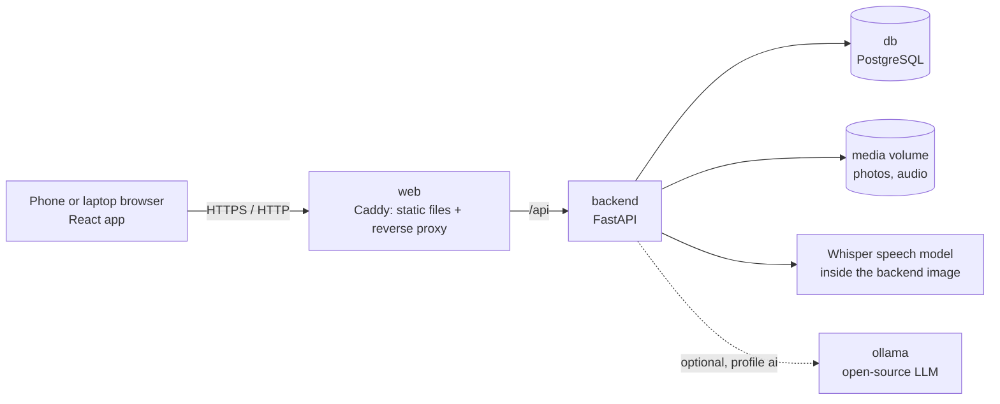

# DeskLess

**Site inspection reports, without the desk.** Walk the site, photograph each issue and say what is wrong in your own mix of Hindi and English. DeskLess transcribes the note, turns it into a structured item (issue, location, severity, owner, due date) and builds a formatted English PDF report. All processing happens on your own machine; nothing is sent to the internet.

Team **techazsure** · iQOO Hackathon 2026 · Productivity track

---

## Run it with one command

You need [Docker](https://docs.docker.com/get-docker/) with Docker Compose (Docker Desktop on Windows and macOS already includes it).

```bash
docker compose up --build
```

Then open **http://localhost:8600** and tap **Load the sample walk-through** to see a finished report in a few seconds.

The first build downloads the dependencies and an open-source speech model (roughly 1 GB in total), so it takes a few minutes. Later starts take seconds and need no network.

To stop: `Ctrl+C`, or `docker compose down`. Your data stays in Docker volumes; `docker compose down -v` deletes it.

### Use it from a phone

DeskLess is built phone-first. With the phone and the computer on the same Wi-Fi (or a hotspot):

1. Find the computer's local IP address (for example `192.168.0.105`).
2. On the phone, open **https://\<that-ip\>:8643**.
3. The browser warns about the certificate, because it is issued locally by the app itself. Choose *Advanced → Proceed*.

HTTPS is needed because browsers only allow the microphone on secure pages. The plain `http://<ip>:8600` address also works, but voice recording then uses the phone's own recorder instead of the in-app one.

### Optional: add a local LLM

By default, speech-to-text is done by a local Whisper model and the structuring is done by built-in rules. To structure items with an open-source LLM running locally (served by [Ollama](https://ollama.com)), start with the `ai` profile:

```bash
docker compose --profile ai up --build
```

This downloads the model once (about 3.3 GB for the default `gemma3:4b`, which can also read the photo). Until the download finishes, and whenever the model is unavailable, the app keeps working with the built-in rules. Each item shows which engine structured it.

---

## What it does

| Step | What happens | Where |
|---|---|---|
| 1. Capture | Take a photo of the issue and record a voice note (or type it). | Phone browser |
| 2. Transcribe | The note is transcribed, and Hindi or mixed speech is rendered in English. | Whisper (`faster-whisper`), local |
| 3. Structure | The note becomes issue, location, severity, owner and due date. | Local LLM via Ollama, or built-in rules |
| 4. Review | Fields that were not stated are left blank and marked for a person to confirm. | Phone browser |
| 5. Report | A formatted English PDF: summary, one entry per issue with its photo, action table. | ReportLab, local |
| 6. Hand-off | Download or share the PDF; copy the action items to the clipboard. | Phone browser |

DeskLess never invents an owner, a due date or a location. If the note did not say it, the field stays empty and is flagged, and it appears as "To be confirmed" in the report. This holds even when a model suggests a value: it is only kept if the note supports it.

## Architecture



| Service | Technology | Purpose |
|---|---|---|
| `web` | React 18, TypeScript, Vite, served by Caddy | Phone-first interface; proxies `/api`; serves HTTPS with a locally issued certificate |
| `backend` | Python 3.12, FastAPI, SQLAlchemy | API, capture pipeline, PDF report |
| `db` | PostgreSQL 16 | Walk-throughs and items |
| `ollama` (optional) | Ollama | Local LLM for structuring and reading the photo |

Only the `web` ports are published. The database and API are reachable only inside the Docker network.

## Project structure

```
product/
├── docker-compose.yml        one command starts everything
├── .env.example              optional settings (ports, models)
├── backend/
│   ├── Dockerfile
│   ├── requirements.txt
│   ├── app/
│   │   ├── main.py           FastAPI app
│   │   ├── models.py         database tables
│   │   ├── routers/          HTTP endpoints
│   │   └── services/
│   │       ├── speech.py     local speech-to-text
│   │       ├── llm.py        optional local LLM (Ollama)
│   │       ├── rules.py      rule-based structuring
│   │       ├── structure.py  combines the two and checks every field against the note
│   │       ├── pipeline.py   recording → transcript → structured item
│   │       └── report.py     PDF report and action list
│   └── tests/
└── frontend/
    ├── Dockerfile
    ├── Caddyfile             web server, reverse proxy, local HTTPS
    └── src/
        ├── pages/            Home, Walkthrough, Capture, Item, Report
        └── components/       voice recorder, shared UI
```

## Configuration

Everything works without configuration. To change a setting, copy `.env.example` to `.env` and edit it.

| Variable | Default | Meaning |
|---|---|---|
| `WEB_PORT` | `8600` | HTTP port on your machine |
| `WEB_TLS_PORT` | `8643` | HTTPS port on your machine (for phones) |
| `WHISPER_MODEL` | `small` | Speech model baked into the image: `tiny`, `base`, `small`, `medium`. Larger is more accurate with mixed Hindi-English but slower. Rebuild after changing it. |
| `LLM_MODEL` | `gemma3:4b` | Model pulled and used by the `ai` profile |
| `OLLAMA_URL` | `http://ollama:11434` | Set to `http://host.docker.internal:11434` to use an Ollama server already running on your machine (it must listen on all interfaces) |
| `POSTGRES_USER`, `POSTGRES_PASSWORD`, `POSTGRES_DB` | `deskless` | Database credentials |

## API

Interactive documentation is served at **http://localhost:8600/api/docs**.

| Method and path | Purpose |
|---|---|
| `GET /api/health` | Status of the database, speech model and LLM |
| `GET /api/inspections`, `POST /api/inspections` | List or create walk-throughs |
| `GET /api/inspections/{id}` | A walk-through with its items |
| `POST /api/inspections/{id}/items` | Add an item: multipart `photo`, `audio` and/or `note` |
| `PATCH /api/items/{id}` | Correct or confirm fields |
| `POST /api/items/{id}/reprocess` | Run transcription and structuring again |
| `GET /api/inspections/{id}/report.pdf` | The PDF report (`?download=true` to save it) |
| `GET /api/inspections/{id}/actions` | Action items as plain text |
| `POST /api/demo` | Create the sample walk-through |

## Tests

The backend tests run against SQLite with the models switched off, so they need no network:

```bash
docker build --target test -t deskless-test backend
docker run --rm deskless-test
```

## Troubleshooting

- **A port is already in use.** Set `WEB_PORT` and `WEB_TLS_PORT` in `.env` to free ports.
- **The phone cannot reach the app.** Both devices must be on the same network, and the computer's firewall must allow the two ports.
- **The microphone button does not record in the app.** Use the `https://` address; browsers block the microphone on plain HTTP pages (except `localhost`).
- **Transcription is slow.** It runs on the CPU. Set `WHISPER_MODEL=base` and rebuild for more speed at lower accuracy.
- **The local LLM is slow or runs out of memory.** Choose a smaller `LLM_MODEL`, or run without the `ai` profile.

## Status and limits

This is a working prototype, not a finished product.

- **Where the models run.** In this build the models run on the computer that runs Docker, and the phone is the capture device on the same local network. The target for the hackathon build is inference on the phone itself.
- **Transcription accuracy.** Mixed Hindi-English speech is transcribed by an open-source Whisper model. It was checked with clear recordings; expect errors with heavy background noise. The transcript can always be corrected by editing the item.
- **No sign-in.** There are no user accounts. Run it on a network you trust.
- **English report.** The PDF is written in English; text in other scripts is not rendered in it.
- **Not an offline app on the phone.** The phone needs to reach the computer; an internet connection is never needed.

## Contact

Team techazsure · founder@techazsure.com · +91 89787 16587
