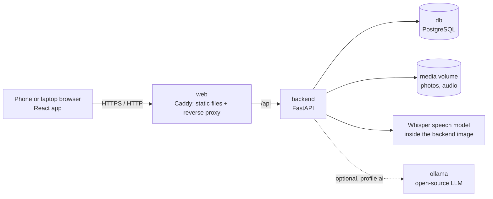

# DeskLess

**Site inspection reports, without the desk.** Walk the site, photograph each issue and say what is wrong in your own mix of Hindi and English. DeskLess turns the voice note into English text, structures it (issue, location, severity, owner, due date) and builds a formatted English PDF report. The models run on the phone and a report is made with no network. When the phone has a network, the finished report goes to the company's server, where each role has its own dashboard.

Team **techazsure** · iQOO Hackathon 2026 Grand Finale · Productivity track

## What is in this repository

| Folder | What it is | Written |
|---|---|---|
| `android/` | **The finale build.** A native Android app that does everything on the phone: camera, voice, speech-to-text and a language model on the device, readings from the phone's sensors, PDF report, and reports passed from phone to phone with no network. No server takes part in making a report, and once signed in the app captures and builds reports in airplane mode. | During the finale, 9–11 Oct 2026 |
| `server/` | **The server.** Accounts for five roles (sign-up with a code sent by email, approval by the level above, sign-in with a unique ID), the reports the phones send, the work on their issues, and a web dashboard for each role. | During the finale, 9–11 Oct 2026 |
| `docker-compose.server.yml`, `deploy/` | **The server on a real machine.** The server and its database alone, and the scripts that put them under a path of an existing site (`deploy/setup.sh`, once) and update them after a push (`deploy/update.sh`). | During the finale, 9–11 Oct 2026 |
| `backend/`, `frontend/` | The web prototype sent with the registration. The phone is the capture device and the models run on the computer that runs Docker. | Before the finale, 4 Oct 2026 |

---

## Run it with one command

You need [Docker](https://docs.docker.com/get-docker/) with Docker Compose (Docker Desktop on Windows and macOS already includes it). Nothing else: no Android Studio, JDK, Node or Python.

```bash
docker compose up --build
```

| Address | What you get |
|---|---|
| **http://localhost:8700** | The Android app: an install page with the APK that was just built from `android/` |
| **http://localhost:8800/dashboard** | The sign-in page of the dashboards: administrator, managing director, manager, inspector, technical |
| **http://localhost:8825** | A test mailbox that catches every email the server sends (opens on this computer only) |
| **http://localhost:8600** | The web prototype. Tap **Load the sample walk-through** to see a finished report |

The APK is also written to `apk/DeskLess.apk` next to `docker-compose.yml`.

A native Android app cannot run inside a container, because it needs the phone's camera, microphone and GPU. So Docker compiles the app, runs its unit tests and serves the result; the app itself runs on the phone. To get it there, open `http://<this computer's IP>:8700` on the phone (same Wi-Fi or hotspot), or send `apk/DeskLess.apk` with iQOO Office Kit file transfer.

To build and serve only the Android app:

```bash
docker compose up --build app
```

The first build downloads a JDK, the Android SDK, Gradle and the app's libraries, plus the prototype's dependencies and speech model (roughly 2 GB in total). Later builds reuse all of it.

To stop: `Ctrl+C`, or `docker compose down`. The prototype's data stays in Docker volumes; `docker compose down -v` deletes it.

Every push also runs the same build on GitHub Actions (`.github/workflows/build.yml`) and attaches the APK to the run as an artifact.

---

## The Android app

### What it does

| Step | What happens | With |
|---|---|---|
| 1. Capture | Take a photo of the issue, or film a clip of up to 20 seconds, and record a voice note. | CameraX, `AudioRecord` (16 kHz WAV) |
| 2. Speech to English text | The note is transcribed on the phone. Hindi or mixed speech comes out in English. Long notes are split at pauses first. | Whisper `small` through sherpa-onnx, Silero VAD |
| 3. Structure | The note and the picture become issue, location, severity, owner and due date. A spoken deadline such as "Monday" becomes a date. | Gemma 4 E2B through LiteRT-LM, on the phone's GPU with a CPU fallback |
| 4. AI check | The model says what it sees in the picture and whether that matches the note. The inspector can retake the picture or confirm it. | Gemma 4 E2B |
| 5. Review | Every field can be edited. Fields filled by a model are marked. | Jetpack Compose |
| 6. Report | An English PDF: counts by severity and type, then one entry per issue with its picture. | Android `PdfDocument` |
| 7. Hand-off | Save to `Documents/DeskLess`, share, send to a laptop with iQOO Office Kit file transfer, or pass it to another phone running DeskLess, directly or through relay phones. | Share sheet, Office Kit, Nearby Connections |
| 8. To the office | The finished report is sent to the company's server by itself, at once or when the phone next has a network. There its issues are given to technicians, fixed and checked, and each role follows them on a dashboard. | The DeskLess server, see [Accounts, roles and dashboards](#accounts-roles-and-dashboards) |

Fields the note did not mention are left empty and printed as "Not stated". The AI check is an opinion: when the inspector overrules it, the report says so.

The same flow serves three kinds of report, chosen on the first screen: site inspection, medication audit and community issue. The choice sets the wording on screen, the issue types and the severity guide given to the model. Issues can be filtered and sorted, and every PDF built on the phone is kept in a reports list.

### The phone as an instrument

Each issue also carries what the phone itself measured. None of it needs a network.

| Part of the phone | What DeskLess does with it |
|---|---|
| Compass and motion sensors | Stamp each picture with the direction the camera faced and whether it was aimed overhead or at ground level. |
| Light sensor | Records the brightness at the spot in lux, and switches the torch on in the dark. |
| Step counter | Counts the steps walked from the previous issue. |
| Satellite position | Records where each issue is and draws the map of the walk in the report. |
| Accelerometer as a level | Reads the slope of a floor, a shelf or a wall in degrees and millimetres per metre. |
| Microphone as a noise meter | Reads the average loudness of a place over three seconds, in decibels. |
| Accelerometer as a vibration meter | Reads how hard a machine shakes and the frequency that stands out. |
| Proximity sensor | Lift the phone to your ear and speak: the voice note records without a button. |
| NFC | Tap a tag on a door, a machine or a medicine fridge and new issues are filed there. A tag is known by its serial number, so any sticker or chip card works. |
| Fingerprint sensor | Signs the finished report. A key kept in the phone's secure hardware signs the PDF and the signature file travels with it; if the PDF is changed, the signature no longer matches. |
| Motor | A different vibration for a picture taken, fields filled, and an issue rated High or Critical. |
| Wide and long cameras | Zoom stops for a whole room or for what is out of reach, where the phone offers them. |

The readings are given to the on-device model together with the note and the picture, printed in the report and written to the spreadsheet. They come from a phone, not from calibrated instruments, and the report says so. The sensors button on the first screen shows each one live.

The signature is plain ECDSA P-256 over the PDF's bytes, so it can be checked outside the app, for example with `openssl dgst -sha256 -verify`.

When nobody says where an issue is, the Location field is filled from what the phone knows: the tagged place, where the camera was aimed, the compass direction and the satellite position. A street address would need the internet, so the app does not look one up.

### AI review: does the report hold together?

Before a report goes out, its own evidence is checked against itself, and the result is printed in the PDF and shown on the report.

| Check | What is compared |
|---|---|
| Pictures against notes | The model's verdict on each picture when it was captured |
| Where | The satellite positions should lie on one site |
| When | The pictures should be in order, and from this walk |
| Sensors against notes | A note that says "dark" against the light reading, "ceiling" against where the camera was aimed, "noisy" against the noise meter, "sloping" against the level |
| Source of the pictures | Pictures can only come from the app's own camera, never from the gallery |

Fixed rules decide what can be decided by rule. The on-device model then reads the evidence and gives its own verdict; it can make the result stricter, never more lenient. The outcome is one of **Looks genuine · Approved**, **Doubtful · Held for a person to check** or **Does not hold together · Rejected**, with each check listed beside it. It is a check of the report's own evidence to help a reviewer. It is not proof.

### Linking phones

Two phones running DeskLess can pass reports directly, with no network.

1. Open the side bar on one phone (the yellow button at the top left). It shows that phone's QR code.
2. On the other phone, tap **Scan another phone** in the side bar and point it at the code. The two are now linked.
3. From then on they find each other by themselves whenever both have DeskLess open. **Share** on a report lets you choose which linked phones get it and sends it: nobody taps Accept on either side, and each phone says "Report sent" or "Report received".

A received report opens by itself if the phone is idle; if its owner is in the middle of capturing an issue, it waits in a "new report" card on the first screen. It arrives with its spreadsheet, calendar, task lists, review and signature, and the signature is checked again on the receiving phone.

The QR code carries the phone's code and a secret. Each phone proves to the other that it knows the secret before anything is exchanged, so a phone that never saw the code is turned away. The transport is Google's Nearby Connections: Bluetooth to find the other phone, and Wi-Fi directly between the two when both have it on. Android asks once to allow nearby devices and location, and offers to switch Bluetooth on if it is off; no app is allowed to switch it on silently.

### Relay: through other phones, sealed

When the phone a report is for is not in range, any linked phone that is in range takes it and carries it, handing it on to the phones it meets until one of them is the phone it is for.

- **Only the chosen phone can open it.** Each copy is sealed for one phone before it leaves: AES-256-GCM under a key agreed (ECDH on P-256) from the sender's key, a one-off key made for that report, and the receiver's public key. A phone carrying it holds the file and can read only the label on the outside: who it is from, who it is for and when it was made. Its side bar lists what it carries and says it cannot open it.
- **The receiver knows who sent it and that nothing was changed.** The sender's own key is part of the seal, and the label is bound to the contents, so a report relabelled or altered on the way does not open.
- **The sender learns it arrived.** The phone that opens a report signs a receipt, which travels back the same way. Each phone that carried a copy drops it on seeing the receipt, and the sender's report screen moves from "waiting" to "with a relay phone, sealed" to "delivered and opened".

Phones exchange their public keys the first time they connect after linking, under the same proof as above, so nobody in between can swap in a key of their own.

### Checked on an iQOO 15

- The whole flow in airplane mode: photo, voice note, filled fields and PDF.
- Gemma 4 E2B running on the phone's Adreno GPU through OpenCL.
- Fields filled about 3 seconds after a short voice note ended (11 seconds on the first run, which also loads the models).
- A video issue from clip to report.

### Not measured yet

- Accuracy on mixed Hindi-English speech.
- The accounts, the dashboards and the sending of reports on a real phone and a real server. They were tried with the Android emulator and the server in Docker on one computer: the sign-up form with a team code, sign-in, a report built on the emulator arriving on the manager's dashboard with its pictures, and the dashboards in a desktop browser at desktop and phone width. Email was sent only to the test mailbox.
- Speed of the picture check on a video issue (three stills) on the phone.
- The medication audit and community issue report types: they were tried on screen only, and no issue has been run through the model under them.
- How well a model of this size judges real site photos. This is why its verdict can always be overruled.
- The sensor features on a real phone. They were written and tried on the Android emulator, where the capture stamp, the level, the noise and vibration meters, lift-to-talk, naming a tag (with a simulated tag) and the signed report work. Real NFC tags, the step counter, the torch, lens switching, the feel of the motor and how close the readings are to real instruments still have to be checked on the phone.
- The speed of the phone link over Wi-Fi between two real phones. Between an iQOO 15 and a Pixel 9a, linking by QR code, connecting with no prompt, the report arriving and the spoken "Report sent" all worked, but that first run stayed on Bluetooth and a 1.9 MB report took over three minutes. The link was then changed so the two phones can move up to a direct Wi-Fi connection, and reports were made about a third of the size; that the phones do reach Wi-Fi speed has not been checked yet. Between two Android emulators the whole flow works, including a report sent while the other phone was closed going by itself once it opened, and the signature verifying on the receiving side.
- The relay between real phones. With three Android emulators it works end to end: a report addressed to a phone out of range went to a relay phone sealed, the relay could not read it and listed nothing new among its reports, the destination opened it when it later met the relay, and the signed receipt came back through the relay to the sender, which then showed "delivered and opened". It has not been run on three real phones.
- How often the AI review holds back a report that is in fact fine. It was tried on one test walk, which it rejected for good reasons (pictures that did not match their notes, positions far apart).

### AI models

The models are open and run on the phone. They are not in this repository or inside the APK (about 2.8 GB). Copy the files to a folder on the phone, open **Models** in the app and import the folder.

| File | Job | From |
|---|---|---|
| `small-encoder.int8.onnx`, `small-decoder.int8.onnx`, `small-tokens.txt` | Speech to English text | Whisper `small` in the [sherpa-onnx](https://github.com/k2-fsa/sherpa-onnx) `asr-models` release |
| `silero_vad.onnx` | Splitting long voice notes | Same release |
| `gemma-4-E2B-it.litertlm` | Structuring and the picture check | `litert-community/gemma-4-E2B-it-litert-lm` on Hugging Face |

The Gemma file can also be given in two halves, `.part1` and `.part2`, for transfer tools with a 2 GB limit. The app joins them and checks the SHA-256.

Without the models the app still takes pictures and voice notes, accepts typed notes and builds the PDF; built-in rules then fill only the title and the severity.

### Build it without Docker

Open `android/` in Android Studio, or from a shell with JDK 25 and Android SDK platform 37 installed:

```bash
cd android
./gradlew assembleDebug
```

Add `-PphoneOnly` for an APK without the emulator's x86_64 libraries (about half the size). Unit tests: `./gradlew testDebugUnitTest`.

### Code

```
android/
├── Dockerfile                builds the APK and serves the install page
├── docker/                   install page and web server settings
└── app/src/main/java/com/techazsure/deskless/
    ├── capture/              photos, video stills, WAV recorder, position, sensors, instruments, NFC tags
    ├── speech/               speech to English text
    ├── structure/            Gemma structuring, due dates, expiry dates, rule-based fallback
    ├── models/               model import and checks
    ├── report/               PDF report, report pack, saved reports, hand-off, fingerprint sign-off, AI review
    ├── link/                 QR pairing, phone-to-phone link, relay and sealed reports, spoken confirmation
    ├── account/              sign-up and sign-in, fingerprint unlock, sending the walk and its report to the server
    ├── data/                 issues and their readings, their storage, report types
    └── ui/                   screens and theme
```

---

## Accounts, roles and dashboards

Nobody uses the app without an account, and every account is approved by the person above. A company has four kinds of people; the platform has one administrator.

| Role | Signs up with | Approved by | ID | What they do |
|---|---|---|---|---|
| Managing Director | The company's name | The administrator | `DL-MD-0001` | Brings the company to DeskLess and sees everything in it. |
| Manager | The managing director's company code | The managing director | `DL-MGR-0001` | Gives issues to technicians, checks their repairs, approves their own team. |
| Inspector | Their manager's team code | Their manager | `DL-INS-0001` | Walks the site and makes the reports, in the app. |
| Technical | Their manager's team code | Their manager | `DL-TEC-0001` | Fixes the issues given to them and shows each repair with a photo. |

The administrator is not an account: there is one, named in the server's settings. The administrator approves each managing director, which creates the company, and may decide any other sign-up. A managing director may decide any sign-up in their company. In a company with no managers, inspectors and technicians can join with the managing director's code.

### From sign-up to sign-in

| Step | Where | What happens |
|---|---|---|
| 1. Sign up | App | Role, name, email, mobile number, Aadhaar number, a photo and a password, with the company's name (managing director) or the code of the person they will report to (everyone else). The form says whose code it is before anything is sent, and is checked on the phone first, the Aadhaar check digit included. |
| 2. Confirm the email | App | A six-digit code is emailed. It works for ten minutes and five tries. |
| 3. Approve | Dashboard | The person above sees the details and photo, and approves or rejects with a reason. They are emailed when someone is waiting. |
| 4. Unique ID | Server | Approval gives the ID the person signs in with. It is emailed, and the waiting app shows it. A managing director or manager also gets the code to hand to their own people. |
| 5. Sign in | App or dashboard | ID and password. The phone keeps the sign-in for 30 days, and the fingerprint unlocks the app each time it is opened. |

A forgotten password is reset in the app with a code sent to the account's email address. Five wrong passwords lock the account for fifteen minutes.

### From a report to a closed issue

1. **The inspector raises issues in the app, and the app sends them by itself.** Each issue goes to the server a few seconds after it is raised and its fields are filled, so it is on the dashboards while the walk is still going on. When the report is built, its PDF follows for the same walk. With no network everything waits on the phone and goes when the network is back; a picture is sent once, after that only the words travel. The app's reports list shows which reports have been sent. A walk told again replaces what was sent before, and work already done on its issues is kept.
2. **The manager gives each issue to a technician**, with a day to have it done by. The technician is emailed.
3. **The technician fixes it and marks it fixed with a photo of the repair**, from the dashboard on their phone.
4. **The manager compares the two pictures** and accepts the repair, which closes the issue, or sends it back with what is still wrong.
5. **The managing director sees all of it in numbers**: what is open, what is overdue, which team is behind.

An issue the inspector already saw repaired on site arrives closed.

### The dashboards

One page for everybody: http://localhost:8800/dashboard on this computer, `https://www.shaikalthaf.in/competitions/iqoo/dashboard` on our server. What it shows depends on who signs in. In the app, **My dashboard** in the side bar opens it already signed in, with a link that works once.

| Who | What they see and do |
|---|---|
| Administrator | A **control room** for the whole platform: companies, who is online, reports and issues across all of them, what is happening as it happens, and the health of the server. Sections for approvals, companies, people, reports, issues and the system itself. Decides sign-ups and can suspend any account; does not hand out work. |
| Managing Director | The company: reports, issues not closed, high or critical, overdue, fixed and waiting for a check; issues by severity, site and type; the last 14 days; each manager's team side by side; what happened lately. Approves managers, and can give out and close any issue. Their company code. |
| Manager | Their team: issues to give out, with technicians, to check, overdue; the team's reports with each PDF and the AI review's verdict; the people in the team and what each has in hand. Approves their inspectors and technicians. Their team code. |
| Inspector | Their own reports, and what has become of each issue they reported. |
| Technical | Their jobs: to do, fixed and waiting for the check, done. Opens a job to see the picture, the note, the place and the deadline, and marks it fixed with a photo. |

What each may see is decided on the server, not on the page: a manager cannot open another team's issue, and one company sees nothing of another.

**The overview is live.** It asks the server again every ten seconds and changes in place, with no reload: numbers count up to their new value and the tile that changed lights up for a moment, bars and the ring slide, a new event drops in at the top of *Happening now*, and people appear under *Online now* as their phone or browser talks to the server. A pill in the corner says when the page last heard from the server, and turns red while it cannot reach it. Only the overview (and the administrator's System section) refreshes by itself. The lists of issues, approvals, people and reports are drawn when they are opened and when **Refresh** is pressed, so nothing moves under somebody's hands, and while an issue, an approval or a picture is open the overview waits too.

| On the overview | What it shows |
|---|---|
| Tiles | The few numbers the role acts on, each with today against yesterday and the last fortnight as a small line. A tile opens the list behind it. |
| Reported and closed | Two lines over the last 14 days. A hairline follows the pointer (or the arrow keys) and reads out both; **Table** shows the same numbers as a table. |
| Where every issue stands | One bar divided by stage (to give out, with technicians, fixed and to check, closed), the count of each, and the share closed. A stage opens its issues. |
| Happening now | Reports arriving, issues given out, fixed, closed or sent back, people joining. An entry opens its issue. |
| Online now | Who has used the app or a dashboard in the last quarter of an hour. |
| By severity, by site, by type | What is not closed, and beside it in grey what already is. |
| Teams, companies | One row each, side by side, with the share of their issues closed. |
| Server health (administrator) | Uptime, the database, whether a mail server is set, requests in the last hour and how quickly they were answered, the last report received, and how full the disk is. The **System** section adds requests and answer time minute by minute, the files kept and the rows stored. |

The lists have a search box and an **Export** button that saves what is on screen as a spreadsheet file. Under **People**, an account can be suspended and let back in by the level above: its sign-ins stop working at once and nothing of its work is removed. The colours of the charts were chosen with a colour-blindness check against the page's dark surface, and no state is shown by colour alone.

### Try it on this computer

```bash
docker compose up --build db server mail
```

1. In the app, sign up as **Managing Director** with a company name. The code arrives in the test mailbox at http://localhost:8825.
2. Open http://localhost:8800/dashboard and sign in as the administrator, `admin@deskless.local`. The password was made on the first start; read it with:

   ```bash
   docker compose exec server sh -c "cat /data/admin-password.txt"
   ```

3. Approve the managing director. The app shows the new ID within a few seconds; sign in with it. The side bar now shows the company code.
4. On other phones (or after signing out), sign up a **Manager** with the company code, then an **Inspector** and a **Technical** with the manager's team code. Each is approved on the dashboard of the person above.
5. As the inspector, build a report. It appears on the manager's dashboard; give an issue to the technician, mark it fixed as the technician, and close it as the manager.

The app has to be able to reach the server. An emulator on the same computer does so as built. For a phone on the same Wi-Fi, build the app with the computer's address (`APP_SERVER_URL=http://<this computer's IP>:8800` in `.env`, or `./gradlew assembleDebug -PserverUrl=...`), or type the address on the app's first screen. A test build may use plain `http://` for this; a release build accepts `https://` only.

### What is stored, and how

| What | How it is kept |
|---|---|
| Password | Never stored. Only a salted scrypt hash of it is. |
| Aadhaar number | Encrypted (AES-256-GCM) with a key that is not in the database. Beside it are its last four digits, for display, and a keyed fingerprint, so the same number cannot be registered twice. No part of the API returns the number: the app, the dashboards and the emails show `XXXX XXXX 1234`. |
| Profile photo | Re-drawn as a plain JPEG of modest size, which drops anything else the file carried, such as where it was taken. Only the person and those above them can fetch it. |
| Reports | The PDF as the phone built it, and each issue's fields. Only the author and those above them in the same company can open them. |
| Issue pictures | Made smaller on the phone before they are sent, and re-drawn on the server like the profile photos. |
| Emailed codes | Only a keyed hash of each code is stored. |
| Sign-in | A signed token: in the app's private storage on the phone, and for the length of the browser session on a dashboard. |

Aadhaar numbers are personal data, and Indian law restricts who may collect and keep them. The handling above is the technical part; whether an organisation may hold them at all is for that organisation to settle before real use.

### On a real server

The app works on its own with no network: it captures, runs the models and builds the report on the phone, and keeps each finished report in an outbox. The server is the other half. It runs in the cloud, takes the reports as the phones come online, and serves the dashboards. Ours runs beside an existing website, under a path of its domain:

| | Address |
|---|---|
| Dashboards | `https://www.shaikalthaf.in/competitions/iqoo/dashboard` |
| What the app talks to | `https://www.shaikalthaf.in/competitions/iqoo/api/...` |

Only the server and its database run there, from `docker-compose.server.yml`: no APK build, no web prototype, no test mailbox. The site's own nginx stays in front, keeps its HTTPS, and passes that one path on. The website itself is not touched, and the project does not have to live in the website's folder: it can be cloned anywhere on the machine, because nginx, not the folder, decides which address leads to it.

**First time, on the server** (it needs Docker, git and the site's nginx):

```bash
git clone https://github.com/Shaik-Althaf-Techazsure/DeskLess_IQOO.git
cd DeskLess_IQOO
sudo bash deploy/setup.sh
```

`deploy/setup.sh` asks three things: the address (Enter takes the one above), the administrator's email, and the mail server that will send the sign-up codes (Enter to set it later). Then it:

1. writes `.env`, readable by its owner only, with an administrator password and the two keys made on the spot;
2. builds and starts the server and its database, and waits until the server answers;
3. puts the nginx lines in a file of their own (`/etc/nginx/snippets/deskless.conf`) and adds one `include` for it as the first line of the site's HTTPS `server { ... }`, so that no other rule of the site comes before it. The site's file is copied to `/etc/nginx/deskless-backup/` first, `nginx -t` is run, and if nginx does not accept the result everything is put back and nothing is reloaded;
4. asks the public address for `/api/health` and prints the dashboard's address and the administrator's sign-in.

It can be run again: an existing `.env` is kept and nginx is not given the line twice. The nginx lines pass `/competitions/iqoo` on in capitals or small letters, with or without `www`, and allow uploads of 64 MB, because a report arrives as one upload with a picture per issue (nginx alone would stop at 1 MB). The server answers the same whether the web server passes the path on or cuts it off, and the dashboard page asks for its style, its script and the API beside itself, so nothing in it depends on the path.

Keep a copy of `SECRET_KEY` and `AADHAAR_KEY` from `.env` somewhere safe: a lost `SECRET_KEY` signs everyone out, a lost `AADHAAR_KEY` makes the stored Aadhaar numbers unreadable for good. Without a mail server (`SMTP_*`) nobody receives their sign-up code; it is only written to the server's log.

By hand instead: copy `.env.example` to `.env` and fill in the server's part, run `docker compose -f docker-compose.server.yml up -d --build`, and add the block in `deploy/nginx.conf` to the site's HTTPS `server { ... }` as its first location.

**After every push to GitHub**, on the server:

```bash
sudo sh deploy/update.sh
```

It pulls, rebuilds, restarts and waits until the server answers. Accounts, reports and pictures are kept: they live in Docker volumes, and a database from an earlier version gains its new columns at start; nothing is dropped.

**The app** has to be built for that address. With Docker: `APP_SERVER_URL=https://www.shaikalthaf.in/competitions/iqoo` in `.env` (or just `PUBLIC_URL`, which it falls back to). With Gradle: `./gradlew assembleDebug -PphoneOnly -PserverUrl=https://www.shaikalthaf.in/competitions/iqoo`. On GitHub, set the repository variable `APP_SERVER_URL` (Settings, Secrets and variables, Actions, Variables) and the APK that every push builds signs in there. The address can also be typed on the app's first screen.

### API

| Method and path | Purpose |
|---|---|
| `POST /api/signup` | The sign-up form with the photo (multipart). Emails the code. |
| `GET /api/signup/invite` | Whose code this is: the company and the person the newcomer would report to |
| `POST /api/signup/verify`, `/api/signup/resend` | Confirm the email address with the code; ask for a new code |
| `GET /api/signup/status` | How a sign-up is doing and who is to decide it, for the phone that made it |
| `POST /api/login`, `POST /api/admin/login` | Sign in: a person with their unique ID, the administrator with their email address |
| `GET /api/me`, `/api/me/photo` | The signed-in person's details and photo |
| `POST /api/password/forgot`, `/api/password/reset` | Reset a forgotten password with an emailed code |
| `POST /api/web-link`, `/api/web-link/open` | A link that works once, with which the app opens the dashboard already signed in |
| `GET /api/people`, `POST /api/people/{id}/approve`, `/reject` | The people below the one asking, the sign-ups waiting for them, and the deciding of those |
| `POST /api/people/{id}/suspend`, `/reactivate` | Shut an approved account out, and let it back in |
| `GET /api/admin/companies`, `/api/admin/system` | Every company, and the server's own health, for the administrator |
| `POST /api/reports` | A phone sends a walk: its issues and the pictures the server lacks, while it is going on, and the PDF once the report is built (multipart) |
| `GET /api/reports`, `/api/reports/{id}/pdf` | The reports in view, and a report's PDF |
| `GET /api/issues`, `/api/issues/{id}`, `/photo`, `/fix-photo` | The issues in view, one issue with its history, and its pictures |
| `GET /api/technicians`, `POST /api/issues/{id}/assign` | Who an issue can be given to; give it out with a deadline |
| `POST /api/issues/{id}/fixed` | The technician marks it fixed, with a photo of the repair (multipart) |
| `POST /api/issues/{id}/close`, `/reopen` | Accept a repair and close the issue; send it back |
| `GET /api/dashboard` | Everything the signed-in person's overview shows: numbers, the fortnight, who is online, what happened lately |
| `GET /api/health` | Status |

FastAPI and SQLAlchemy on PostgreSQL, in `server/`; the dashboard is one page of plain HTML, CSS and JavaScript in `server/app/static/`, with no build step. The tests run the account flow, the roles, the work on an issue and each refusal:

```bash
docker build --target test -t deskless-server-test server
docker run --rm deskless-server-test
```

---

## The web prototype

Built before the finale to show the idea. It starts with the same `docker compose up --build` and is served at **http://localhost:8600**.

### Use it from a phone

With the phone and the computer on the same Wi-Fi (or a hotspot):

1. Find the computer's local IP address (for example `192.168.0.105`).
2. On the phone, open **https://\<that-ip\>:8643**.
3. The browser warns about the certificate, because it is issued locally by the app itself. Choose *Advanced → Proceed*.

HTTPS is needed because browsers only allow the microphone on secure pages. The plain `http://<ip>:8600` address also works, but voice recording then uses the phone's own recorder instead of the in-app one.

### Optional: add a local LLM

By default, speech-to-text is done by a local Whisper model and the structuring is done by built-in rules. To structure items with an open-source LLM running locally (served by [Ollama](https://ollama.com)), start with the `ai` profile:

```bash
docker compose --profile ai up --build
```

This downloads the model once (about 3.3 GB for the default `gemma3:4b`, which can also read the photo). Until the download finishes, and whenever the model is unavailable, the app keeps working with the built-in rules. Each item shows which engine structured it.

### What it does

| Step | What happens | Where |
|---|---|---|
| 1. Capture | Take a photo of the issue and record a voice note (or type it). | Phone browser |
| 2. Transcribe | The note is transcribed, and Hindi or mixed speech is rendered in English. | Whisper (`faster-whisper`), local |
| 3. Structure | The note becomes issue, location, severity, owner and due date. | Local LLM via Ollama, or built-in rules |
| 4. Review | Fields that were not stated are left blank and marked for a person to confirm. | Phone browser |
| 5. Report | A formatted English PDF: summary, one entry per issue with its photo, action table. | ReportLab, local |
| 6. Hand-off | Download or share the PDF; copy the action items to the clipboard. | Phone browser |

The prototype never invents an owner, a due date or a location. If the note did not say it, the field stays empty and is flagged, and it appears as "To be confirmed" in the report. This holds even when a model suggests a value: it is only kept if the note supports it.

### Architecture



| Service | Technology | Purpose |
|---|---|---|
| `web` | React 18, TypeScript, Vite, served by Caddy | Phone-first interface; proxies `/api`; serves HTTPS with a locally issued certificate |
| `backend` | Python 3.12, FastAPI, SQLAlchemy | API, capture pipeline, PDF report |
| `db` | PostgreSQL 16 | Walk-throughs and items |
| `ollama` (optional) | Ollama | Local LLM for structuring and reading the photo |

Only the `web` ports are published. The database and API are reachable only inside the Docker network.

### Project structure

```
├── docker-compose.yml        one command starts everything
├── .env.example              optional settings (ports, models)
├── backend/
│   ├── Dockerfile
│   ├── requirements.txt
│   ├── app/
│   │   ├── main.py           FastAPI app
│   │   ├── models.py         database tables
│   │   ├── routers/          HTTP endpoints
│   │   └── services/
│   │       ├── speech.py     local speech-to-text
│   │       ├── llm.py        optional local LLM (Ollama)
│   │       ├── rules.py      rule-based structuring
│   │       ├── structure.py  combines the two and checks every field against the note
│   │       ├── pipeline.py   recording → transcript → structured item
│   │       └── report.py     PDF report and action list
│   └── tests/
└── frontend/
    ├── Dockerfile
    ├── Caddyfile             web server, reverse proxy, local HTTPS
    └── src/
        ├── pages/            Home, Walkthrough, Capture, Item, Report
        └── components/       voice recorder, shared UI
```

### API

Interactive documentation is served at **http://localhost:8600/api/docs**.

| Method and path | Purpose |
|---|---|
| `GET /api/health` | Status of the database, speech model and LLM |
| `GET /api/inspections`, `POST /api/inspections` | List or create walk-throughs |
| `GET /api/inspections/{id}` | A walk-through with its items |
| `POST /api/inspections/{id}/items` | Add an item: multipart `photo`, `audio` and/or `note` |
| `PATCH /api/items/{id}` | Correct or confirm fields |
| `POST /api/items/{id}/reprocess` | Run transcription and structuring again |
| `GET /api/inspections/{id}/report.pdf` | The PDF report (`?download=true` to save it) |
| `GET /api/inspections/{id}/actions` | Action items as plain text |
| `POST /api/demo` | Create the sample walk-through |

### Tests

The backend tests run against SQLite with the models switched off, so they need no network:

```bash
docker build --target test -t deskless-test backend
docker run --rm deskless-test
```

### Status and limits

The prototype is a working demonstration, not a finished product.

- **Where the models run.** On the computer that runs Docker, with the phone as the capture device on the same local network. The Android app in `android/` is the build that runs them on the phone.
- **Transcription accuracy.** Mixed Hindi-English speech is transcribed by an open-source Whisper model. It was checked with clear recordings; expect errors with heavy background noise. The transcript can always be corrected by editing the item.
- **No sign-in.** There are no user accounts. Run it on a network you trust.
- **English report.** The PDF is written in English; text in other scripts is not rendered in it.

---

## Configuration

Everything works without configuration. To change a setting, copy `.env.example` to `.env` and edit it.

| Variable | Default | Meaning |
|---|---|---|
| `APP_PORT` | `8700` | Port of the Android app's install page |
| `SERVER_PORT` | `8800` | Port of the server: the app's API and the dashboards |
| `PUBLIC_URL` | empty | On a real server, the address people reach it at, with the path it sits under on the domain. Empty on a developer's machine. |
| `MAIL_PORT` | `8825` | Port of the test mailbox |
| `APP_SERVER_URL` | `PUBLIC_URL` | The server the built app signs in and sends reports to. With both empty, the app is built for an emulator on this computer. |
| `ADMIN_EMAIL` | `admin@deskless.local` | The administrator, who approves each company's managing director |
| `ADMIN_PASSWORD`, `SECRET_KEY`, `AADHAAR_KEY` | made on first start | The administrator's password, the key that signs sign-ins, and the key that encrypts Aadhaar numbers. Set all three on a real server. |
| `SMTP_HOST`, `SMTP_PORT`, `SMTP_SECURITY`, `SMTP_USER`, `SMTP_PASSWORD`, `MAIL_FROM` | the test mailbox | A real mail server, to send real email |
| `UTC_OFFSET_MINUTES` | `330` | The company's clock against UTC (330 is India). A deadline is overdue by that clock. |
| `WEB_PORT` | `8600` | HTTP port of the web prototype |
| `WEB_TLS_PORT` | `8643` | HTTPS port of the web prototype (for phones) |
| `WHISPER_MODEL` | `small` | Speech model baked into the prototype's backend image: `tiny`, `base`, `small`, `medium`. Larger is more accurate with mixed Hindi-English but slower. Rebuild after changing it. |
| `LLM_MODEL` | `gemma3:4b` | Model pulled and used by the `ai` profile |
| `OLLAMA_URL` | `http://ollama:11434` | Set to `http://host.docker.internal:11434` to use an Ollama server already running on your machine (it must listen on all interfaces) |
| `POSTGRES_USER`, `POSTGRES_PASSWORD`, `POSTGRES_DB` | `deskless` | Database credentials |

## Troubleshooting

- **A port is already in use.** Set `APP_PORT`, `SERVER_PORT`, `MAIL_PORT`, `WEB_PORT` and `WEB_TLS_PORT` in `.env` to free ports.
- **The app says it cannot reach the server.** Open `http://<the computer's IP>:8800` in the phone's browser. If that does not open either, the phone is on another network or the computer's firewall blocks port 8800. If it opens, tap the server address on the app's first screen and correct it.
- **The sign-up code does not arrive.** Without `SMTP_*` settings no real email is sent: the code is in the test mailbox at http://localhost:8825.
- **A report does not show on the dashboard.** The app's reports list says whether it was sent. One that is still waiting goes when the phone can reach the server; opening the app with a network sends it.
- **The phone cannot reach the computer.** Both devices must be on the same network, and the computer's firewall must allow the ports.
- **Android refuses to install the APK over an older DeskLess.** Every build from this repository is signed with the same debug key (`android/app/debug.keystore`), so builds install over each other. A copy signed elsewhere has to be uninstalled first, which also removes the imported models.
- **The first build stops on a slow connection.** Run the command again. Finished downloads are kept.
- **The microphone button does not record in the web prototype.** Use the `https://` address; browsers block the microphone on plain HTTP pages (except `localhost`).
- **Transcription in the web prototype is slow.** It runs on the CPU. Set `WHISPER_MODEL=base` and rebuild for more speed at lower accuracy.
- **The prototype's local LLM is slow or runs out of memory.** Choose a smaller `LLM_MODEL`, or run without the `ai` profile.

## Contact

Team techazsure · founder@techazsure.com · +91 89787 16587
