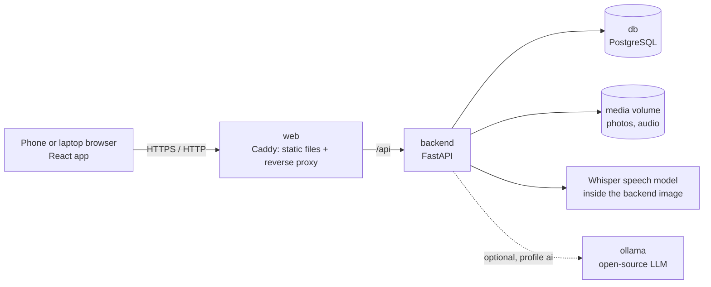

# DeskLess

**Site inspection reports, without the desk.** Walk the site, photograph each issue and say what is wrong in your own mix of Hindi and English. DeskLess turns the voice note into English text, structures it (issue, location, severity, owner, due date) and builds a formatted English PDF report. Nothing is sent to the internet.

Team **techazsure** · iQOO Hackathon 2026 Grand Finale · Productivity track

## What is in this repository

| Folder | What it is | Written |
|---|---|---|
| `android/` | **The finale build.** A native Android app that does everything on the phone: camera, voice, speech-to-text and a language model on the device, PDF report. No server, and it works in airplane mode. | During the finale, 9–11 Oct 2026 |
| `backend/`, `frontend/` | The web prototype sent with the registration. The phone is the capture device and the models run on the computer that runs Docker. | Before the finale, 4 Oct 2026 |

---

## Run it with one command

You need [Docker](https://docs.docker.com/get-docker/) with Docker Compose (Docker Desktop on Windows and macOS already includes it). Nothing else: no Android Studio, JDK, Node or Python.

```bash
docker compose up --build
```

| Address | What you get |
|---|---|
| **http://localhost:8700** | The Android app: an install page with the APK that was just built from `android/` |
| **http://localhost:8600** | The web prototype. Tap **Load the sample walk-through** to see a finished report |

The APK is also written to `apk/DeskLess.apk` next to `docker-compose.yml`.

A native Android app cannot run inside a container, because it needs the phone's camera, microphone and GPU. So Docker compiles the app, runs its unit tests and serves the result; the app itself runs on the phone. To get it there, open `http://<this computer's IP>:8700` on the phone (same Wi-Fi or hotspot), or send `apk/DeskLess.apk` with iQOO Office Kit file transfer.

To build and serve only the Android app:

```bash
docker compose up --build app
```

The first build downloads a JDK, the Android SDK, Gradle and the app's libraries, plus the prototype's dependencies and speech model (roughly 2 GB in total). Later builds reuse all of it.

To stop: `Ctrl+C`, or `docker compose down`. The prototype's data stays in Docker volumes; `docker compose down -v` deletes it.

Every push also runs the same build on GitHub Actions (`.github/workflows/build.yml`) and attaches the APK to the run as an artifact.

---

## The Android app

### What it does

| Step | What happens | With |
|---|---|---|
| 1. Capture | Take a photo of the issue, or film a clip of up to 20 seconds, and record a voice note. | CameraX, `AudioRecord` (16 kHz WAV) |
| 2. Speech to English text | The note is transcribed on the phone. Hindi or mixed speech comes out in English. Long notes are split at pauses first. | Whisper `small` through sherpa-onnx, Silero VAD |
| 3. Structure | The note and the picture become issue, location, severity, owner and due date. A spoken deadline such as "Monday" becomes a date. | Gemma 4 E2B through LiteRT-LM, on the phone's GPU with a CPU fallback |
| 4. AI check | The model says what it sees in the picture and whether that matches the note. The inspector can retake the picture or confirm it. | Gemma 4 E2B |
| 5. Review | Every field can be edited. Fields filled by a model are marked. | Jetpack Compose |
| 6. Report | An English PDF: counts by severity and type, then one entry per issue with its picture. | Android `PdfDocument` |
| 7. Hand-off | Save to `Documents/DeskLess`, share, or send to a laptop with iQOO Office Kit file transfer. | Share sheet, Office Kit |

Fields the note did not mention are left empty and printed as "Not stated". The AI check is an opinion: when the inspector overrules it, the report says so.

The same flow serves three kinds of report, chosen on the first screen: site inspection, medication audit and community issue. The choice sets the wording on screen, the issue types and the severity guide given to the model. Issues can be filtered and sorted, and every PDF built on the phone is kept in a reports list.

### Checked on an iQOO 15

- The whole flow in airplane mode: photo, voice note, filled fields and PDF.
- Gemma 4 E2B running on the phone's Adreno GPU through OpenCL.
- Fields filled about 3 seconds after a short voice note ended (11 seconds on the first run, which also loads the models).
- A video issue from clip to report.

### Not measured yet

- Accuracy on mixed Hindi-English speech.
- Speed of the picture check on a video issue (three stills) on the phone.
- The medication audit and community issue report types: they were tried on screen only, and no issue has been run through the model under them.
- How well a model of this size judges real site photos. This is why its verdict can always be overruled.

### AI models

The models are open and run on the phone. They are not in this repository or inside the APK (about 2.8 GB). Copy the files to a folder on the phone, open **Models** in the app and import the folder.

| File | Job | From |
|---|---|---|
| `small-encoder.int8.onnx`, `small-decoder.int8.onnx`, `small-tokens.txt` | Speech to English text | Whisper `small` in the [sherpa-onnx](https://github.com/k2-fsa/sherpa-onnx) `asr-models` release |
| `silero_vad.onnx` | Splitting long voice notes | Same release |
| `gemma-4-E2B-it.litertlm` | Structuring and the picture check | `litert-community/gemma-4-E2B-it-litert-lm` on Hugging Face |

The Gemma file can also be given in two halves, `.part1` and `.part2`, for transfer tools with a 2 GB limit. The app joins them and checks the SHA-256.

Without the models the app still takes pictures and voice notes, accepts typed notes and builds the PDF; built-in rules then fill only the title and the severity.

### Build it without Docker

Open `android/` in Android Studio, or from a shell with JDK 25 and Android SDK platform 37 installed:

```bash
cd android
./gradlew assembleDebug
```

Add `-PphoneOnly` for an APK without the emulator's x86_64 libraries (about half the size). Unit tests: `./gradlew testDebugUnitTest`.

### Code

```
android/
├── Dockerfile                builds the APK and serves the install page
├── docker/                   install page and web server settings
└── app/src/main/java/com/techazsure/deskless/
    ├── capture/              photos, video stills, WAV recorder
    ├── speech/               speech to English text
    ├── structure/            Gemma structuring, due dates, rule-based fallback
    ├── models/               model import and checks
    ├── report/               PDF report, saved reports, hand-off
    ├── data/                 issues, their storage, report types
    └── ui/                   screens and theme
```

---

## The web prototype

Built before the finale to show the idea. It starts with the same `docker compose up --build` and is served at **http://localhost:8600**.

### Use it from a phone

With the phone and the computer on the same Wi-Fi (or a hotspot):

1. Find the computer's local IP address (for example `192.168.0.105`).
2. On the phone, open **https://\<that-ip\>:8643**.
3. The browser warns about the certificate, because it is issued locally by the app itself. Choose *Advanced → Proceed*.

HTTPS is needed because browsers only allow the microphone on secure pages. The plain `http://<ip>:8600` address also works, but voice recording then uses the phone's own recorder instead of the in-app one.

### Optional: add a local LLM

By default, speech-to-text is done by a local Whisper model and the structuring is done by built-in rules. To structure items with an open-source LLM running locally (served by [Ollama](https://ollama.com)), start with the `ai` profile:

```bash
docker compose --profile ai up --build
```

This downloads the model once (about 3.3 GB for the default `gemma3:4b`, which can also read the photo). Until the download finishes, and whenever the model is unavailable, the app keeps working with the built-in rules. Each item shows which engine structured it.

### What it does

| Step | What happens | Where |
|---|---|---|
| 1. Capture | Take a photo of the issue and record a voice note (or type it). | Phone browser |
| 2. Transcribe | The note is transcribed, and Hindi or mixed speech is rendered in English. | Whisper (`faster-whisper`), local |
| 3. Structure | The note becomes issue, location, severity, owner and due date. | Local LLM via Ollama, or built-in rules |
| 4. Review | Fields that were not stated are left blank and marked for a person to confirm. | Phone browser |
| 5. Report | A formatted English PDF: summary, one entry per issue with its photo, action table. | ReportLab, local |
| 6. Hand-off | Download or share the PDF; copy the action items to the clipboard. | Phone browser |

The prototype never invents an owner, a due date or a location. If the note did not say it, the field stays empty and is flagged, and it appears as "To be confirmed" in the report. This holds even when a model suggests a value: it is only kept if the note supports it.

### Architecture



| Service | Technology | Purpose |
|---|---|---|
| `web` | React 18, TypeScript, Vite, served by Caddy | Phone-first interface; proxies `/api`; serves HTTPS with a locally issued certificate |
| `backend` | Python 3.12, FastAPI, SQLAlchemy | API, capture pipeline, PDF report |
| `db` | PostgreSQL 16 | Walk-throughs and items |
| `ollama` (optional) | Ollama | Local LLM for structuring and reading the photo |

Only the `web` ports are published. The database and API are reachable only inside the Docker network.

### Project structure

```
├── docker-compose.yml        one command starts everything
├── .env.example              optional settings (ports, models)
├── backend/
│   ├── Dockerfile
│   ├── requirements.txt
│   ├── app/
│   │   ├── main.py           FastAPI app
│   │   ├── models.py         database tables
│   │   ├── routers/          HTTP endpoints
│   │   └── services/
│   │       ├── speech.py     local speech-to-text
│   │       ├── llm.py        optional local LLM (Ollama)
│   │       ├── rules.py      rule-based structuring
│   │       ├── structure.py  combines the two and checks every field against the note
│   │       ├── pipeline.py   recording → transcript → structured item
│   │       └── report.py     PDF report and action list
│   └── tests/
└── frontend/
    ├── Dockerfile
    ├── Caddyfile             web server, reverse proxy, local HTTPS
    └── src/
        ├── pages/            Home, Walkthrough, Capture, Item, Report
        └── components/       voice recorder, shared UI
```

### API

Interactive documentation is served at **http://localhost:8600/api/docs**.

| Method and path | Purpose |
|---|---|
| `GET /api/health` | Status of the database, speech model and LLM |
| `GET /api/inspections`, `POST /api/inspections` | List or create walk-throughs |
| `GET /api/inspections/{id}` | A walk-through with its items |
| `POST /api/inspections/{id}/items` | Add an item: multipart `photo`, `audio` and/or `note` |
| `PATCH /api/items/{id}` | Correct or confirm fields |
| `POST /api/items/{id}/reprocess` | Run transcription and structuring again |
| `GET /api/inspections/{id}/report.pdf` | The PDF report (`?download=true` to save it) |
| `GET /api/inspections/{id}/actions` | Action items as plain text |
| `POST /api/demo` | Create the sample walk-through |

### Tests

The backend tests run against SQLite with the models switched off, so they need no network:

```bash
docker build --target test -t deskless-test backend
docker run --rm deskless-test
```

### Status and limits

The prototype is a working demonstration, not a finished product.

- **Where the models run.** On the computer that runs Docker, with the phone as the capture device on the same local network. The Android app in `android/` is the build that runs them on the phone.
- **Transcription accuracy.** Mixed Hindi-English speech is transcribed by an open-source Whisper model. It was checked with clear recordings; expect errors with heavy background noise. The transcript can always be corrected by editing the item.
- **No sign-in.** There are no user accounts. Run it on a network you trust.
- **English report.** The PDF is written in English; text in other scripts is not rendered in it.

---

## Configuration

Everything works without configuration. To change a setting, copy `.env.example` to `.env` and edit it.

| Variable | Default | Meaning |
|---|---|---|
| `APP_PORT` | `8700` | Port of the Android app's install page |
| `WEB_PORT` | `8600` | HTTP port of the web prototype |
| `WEB_TLS_PORT` | `8643` | HTTPS port of the web prototype (for phones) |
| `WHISPER_MODEL` | `small` | Speech model baked into the prototype's backend image: `tiny`, `base`, `small`, `medium`. Larger is more accurate with mixed Hindi-English but slower. Rebuild after changing it. |
| `LLM_MODEL` | `gemma3:4b` | Model pulled and used by the `ai` profile |
| `OLLAMA_URL` | `http://ollama:11434` | Set to `http://host.docker.internal:11434` to use an Ollama server already running on your machine (it must listen on all interfaces) |
| `POSTGRES_USER`, `POSTGRES_PASSWORD`, `POSTGRES_DB` | `deskless` | Database credentials |

## Troubleshooting

- **A port is already in use.** Set `APP_PORT`, `WEB_PORT` and `WEB_TLS_PORT` in `.env` to free ports.
- **The phone cannot reach the computer.** Both devices must be on the same network, and the computer's firewall must allow the ports.
- **Android refuses to install the APK over an older DeskLess.** Every build from this repository is signed with the same debug key (`android/app/debug.keystore`), so builds install over each other. A copy signed elsewhere has to be uninstalled first, which also removes the imported models.
- **The first build stops on a slow connection.** Run the command again. Finished downloads are kept.
- **The microphone button does not record in the web prototype.** Use the `https://` address; browsers block the microphone on plain HTTP pages (except `localhost`).
- **Transcription in the web prototype is slow.** It runs on the CPU. Set `WHISPER_MODEL=base` and rebuild for more speed at lower accuracy.
- **The prototype's local LLM is slow or runs out of memory.** Choose a smaller `LLM_MODEL`, or run without the `ai` profile.

## Contact

Team techazsure · founder@techazsure.com · +91 89787 16587
